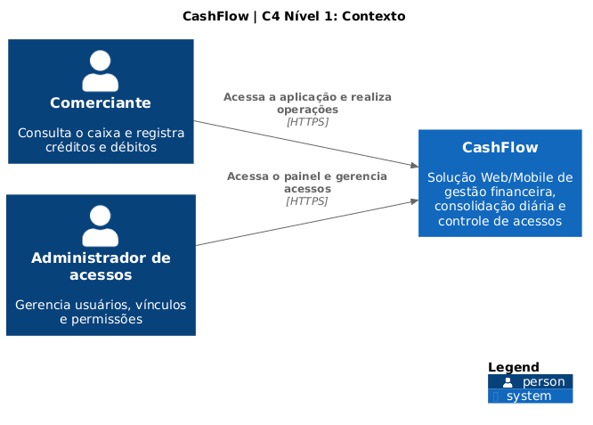
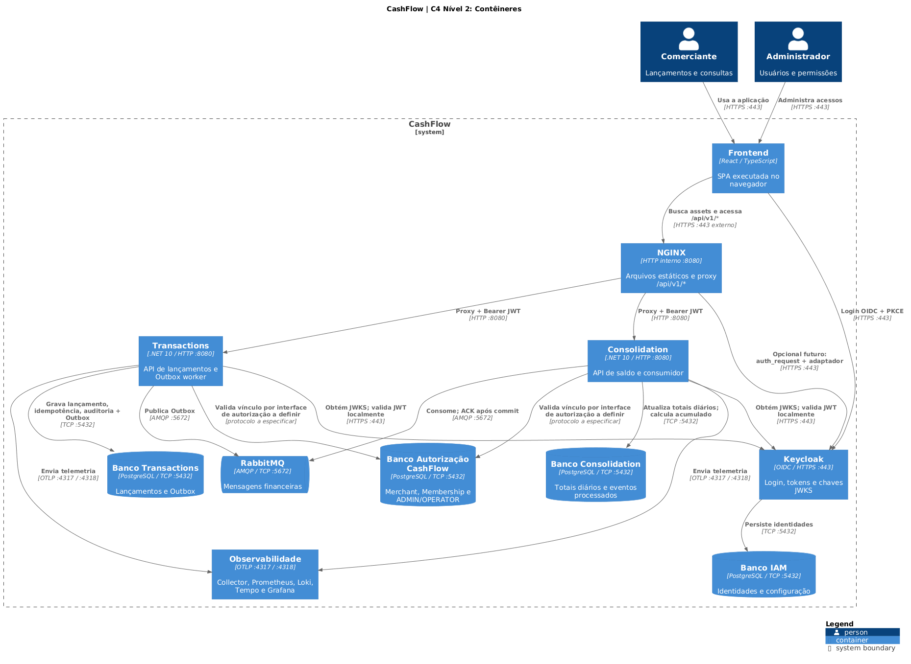
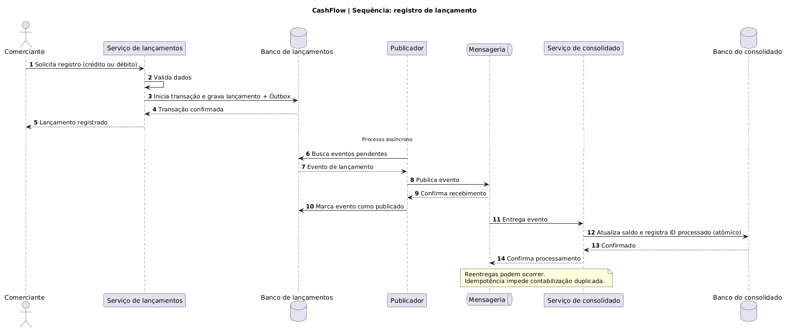
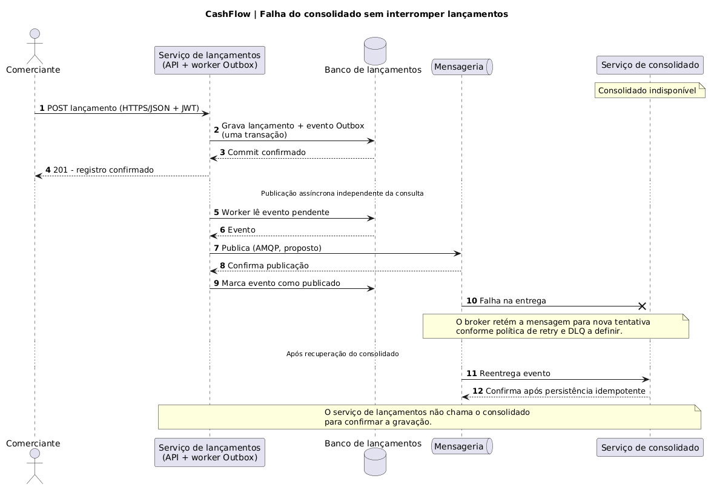
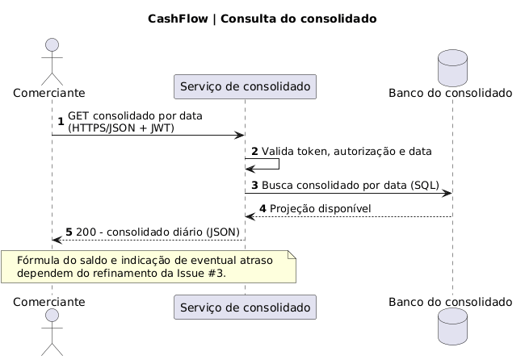

# Diagramas da arquitetura CashFlow

> **Issue:** #6 | **Milestone:** M2 - Arquitetura da solução  
> **Estado:** proposta para revisão  
> **Formato:** PlantUML + C4-PlantUML

## 1. Visão geral

O comerciante registra débitos e créditos e consulta o saldo diário. A principal restrição do desafio é que **o registro de lançamentos deve continuar funcionando se o consolidado estiver indisponível**.

Os diagramas C4 usam a biblioteca **C4-PlantUML**, com símbolos padronizados para pessoa, sistema, contêiner, banco de dados e mensageria. Os fluxos de sequência usam PlantUML convencional, pois não representam um nível do C4 Model.

## 2. Diagramas ilustrados

Os diagramas abaixo são as imagens renderizadas dos arquivos PlantUML correspondentes. Os arquivos `.puml` continuam sendo a fonte editável.

**C4 Nível 1: Contexto**



**C4 Nível 2: Contêineres**



**Sequência: registro de lançamento**



**Sequência: falha do consolidado**



**Sequência: consulta do consolidado**



> **Publicação das imagens:** para exibir essas prévias no GitHub, os cinco PNGs precisam estar na pasta `docs/architecture/images/`. Os arquivos foram preparados a partir das capturas fornecidas. Os links das imagens funcionarão após o upload.

## 3. Arquivos editáveis

| Visão | Pergunta que responde | Fonte |
| --- | --- | --- |
| **C4 nível 1: Contexto** | Quem utiliza o CashFlow? | [c4-context.puml](c4-context.puml) |
| **C4 nível 2: Contêineres** | Como dividimos os serviços e seus dados? | [c4-containers.puml](c4-containers.puml) |
| **Sequência: registro** | Como registrar e depois consolidar um lançamento? | [sequence-register.puml](sequence-register.puml) |
| **Sequência: falha** | Por que registrar continua possível com o consolidado fora do ar? | [sequence-failure.puml](sequence-failure.puml) |
| **Sequência: consulta** | Como o comerciante consulta o resultado do dia? | [sequence-query.puml](sequence-query.puml) |

## 4. Responsabilidades na arquitetura proposta

- **Serviço de lançamentos:** recebe, valida e confirma registros financeiros.
- **Banco de lançamentos:** guarda lançamentos confirmados e eventos pendentes na mesma transação.
- **Publicador de eventos:** encaminha os eventos pendentes ao broker.
- **Mensageria:** entrega eventos ao consumidor, inclusive após falhas temporárias.
- **Serviço de consolidado:** mantém a visão agregada por data e oferece consulta.
- **Banco do consolidado:** guarda resultados calculados e identificadores já processados.

O fluxo de registro **não chama o consolidado**. O processamento assíncrono pode atrasar, mas um lançamento já confirmado deve permanecer preservado.

A arquitetura contempla a proposta de **Transactional Outbox** e **idempotência**. A escolha de tecnologias, a política de retentativas e as garantias operacionais serão formalizadas nas ADRs e nos documentos de resiliência das próximas issues.

## 5. Decisões ainda pendentes

- **Issue #3:** definição de saldo diário, histórico e política de estorno.
- **Issue #7:** linguagem, framework, persistência, mensageria e trade-offs.
- **Issue #8:** estratégias de recuperação, reentrega, DLQ e reconciliação.
- **Issue #9:** segurança, proteção de dados e LGPD.
- **Issue #10:** implantação de referência, custos e impactos operacionais.

Não há definição de cloud no enunciado; os diagramas são independentes de fornecedor.

## 6. Como visualizar ou editar

Os arquivos **.puml** são a fonte dos diagramas e podem ser abertos no **VS Code com a extensão PlantUML** ou renderizados com o PlantUML CLI. Os diagramas C4 incluem a biblioteca que já vem na distribuição moderna do PlantUML:

```plantuml
!include <C4/C4_Container>
```

Para gerar imagens localmente com uma instalação do PlantUML, execute a partir da raiz do projeto:

```bash
plantuml -tsvg docs/architecture/*.puml
```

**Observação:** o GitHub não gera automaticamente a imagem de arquivos `.puml` na visualização de Markdown. Para apresentar os diagramas diretamente na página, poderemos versionar também os SVGs gerados em uma próxima revisão. Não foi feita validação visual das imagens neste commit.

## 7. Critérios da Issue #6

- [x] C4 contexto criado usando elementos C4.
- [x] C4 contêineres criado usando elementos C4.
- [x] Fluxos de registro, falha e consulta criados em PlantUML.
- [x] Padrão de nomenclatura e formato de fontes definidos.
- [x] Fontes editáveis versionadas no repositório.
- [ ] Renderizar e revisar layout visual e legibilidade.
- [ ] Aprovação final.
