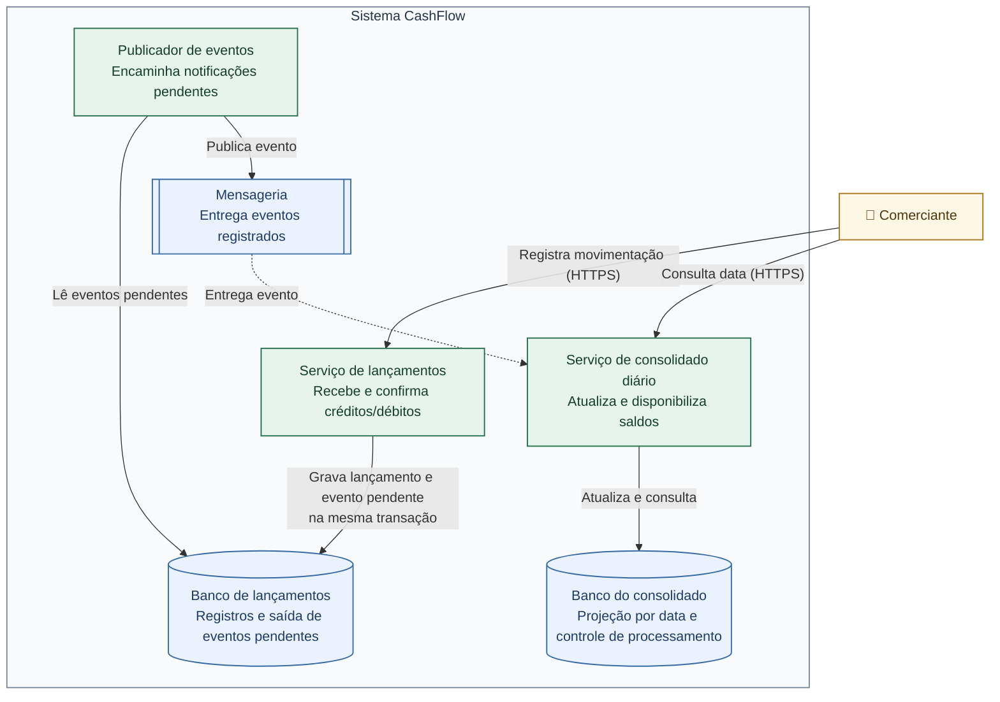
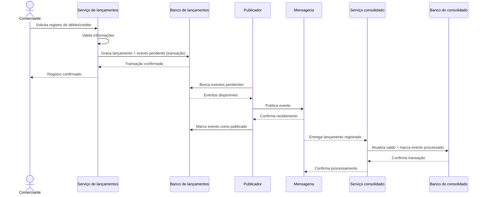
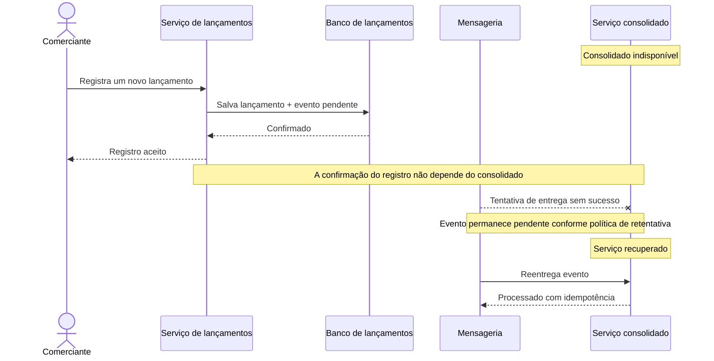
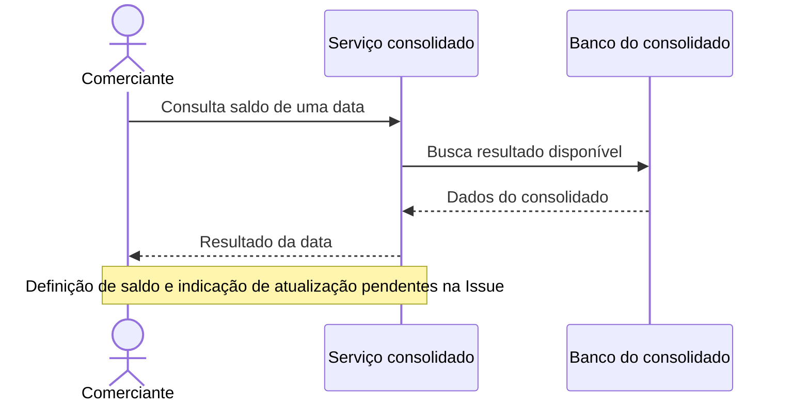

# Arquitetura da solução: contexto, contêineres e fluxos

> **Projeto:** CashFlow Architecture  
> **Issue:** #6 | **Milestone:** M2 - Arquitetura da solução  
> **Estado:** proposta de arquitetura para revisão  
> **Referências:** [Domínios](../domain/business-capabilities-and-context-map.md), [Requisitos funcionais](../requirements/functional-requirements.md), [Requisitos não funcionais](../requirements/non-functional-requirements.md) e [Riscos](../requirements/priorities-assumptions-risks.md)

## 1. Visão geral

O comerciante registra créditos e débitos e consulta o saldo consolidado de um dia. O ponto mais importante do desafio é preservar o **registro de lançamentos mesmo quando a consolidação estiver indisponível**.

Apresentamos duas visões inspiradas no **C4 Model**: contexto (C1) e contêineres (C2), seguidas de fluxos de sequência. A visão C1 mostra o sistema como um todo. A C2 apresenta uma **arquitetura alvo proposta**, ainda sujeita às decisões formais da Issue #7 (ADRs).

**Leitura dos diagramas:** caixas verdes indicam componentes do CashFlow; caixas azuis indicam persistência ou troca de mensagens; setas contínuas representam solicitações ou gravações; setas tracejadas representam eventos ou retornos. Os nomes são mantidos em português e a direção das setas segue o fluxo da informação.

## 2. C1: contexto do sistema

**Pergunta respondida:** quem utiliza o CashFlow e para quê?

O comerciante é o único ator confirmado pelo enunciado. Não aparecem sistemas externos ou legados porque sua existência não foi informada.

## 3. C2: contêineres da arquitetura alvo proposta

**Pergunta respondida:** como dividiremos as responsabilidades e os dados para que um problema no consolidado não interrompa os lançamentos?

### Responsabilidades

| Contêiner | Principal responsabilidade | Impacto se ficar indisponível |
| --- | --- | --- |
| Serviço de lançamentos | Aceitar e consultar registros financeiros | Novos registros ficam indisponíveis; é o serviço mais sensível para a continuidade do negócio. |
| Banco de lançamentos | Manter registros confirmados e eventos pendentes | Pode impedir novas gravações; exige proteção própria. |
| Publicador de eventos | Encaminhar eventos já gravados | A consolidação atrasa, mas o registro pode continuar. |
| Mensageria | Entregar eventos ao consolidado | Eventos aguardam publicação ou processamento; o registro não depende da disponibilidade do broker em cada solicitação. |
| Serviço de consolidado diário | Atualizar a projeção e atender consultas de saldo | Relatórios ficam indisponíveis ou deixam de atualizar; lançamentos continuam. |
| Banco do consolidado | Guardar saldos calculados e identificadores processados | Consultas ficam afetadas; a estratégia de reconstrução será detalhada. |

**Decisão ainda não homologada:** a separação de bancos, o uso de um publicador/Outbox e a mensageria representam uma proposta arquitetural para atender à independência entre serviços. Produtos como PostgreSQL, RabbitMQ e a linguagem serão selecionados ou rejeitados formalmente nas ADRs da Issue #7.

**Importante:** a consulta entra diretamente no serviço de consolidado, sem passar pelo serviço de lançamentos. Isso evita acoplamento desnecessário de leitura. Autenticação, autorização, proteção de dados e ingressos de rede serão tratados na Issue #9.

## 4. Fluxo principal: registrar lançamento

**O que esse fluxo demonstra:** o comerciante recebe confirmação depois que o lançamento está salvo. A atualização do consolidado acontece em outro momento. Uma eventual duplicidade de entrega será controlada por identificador único e processamento idempotente.

## 5. Fluxo de falha: consolidado indisponível

**Limite do cenário:** o requisito cobre falha do serviço consolidado. Uma indisponibilidade do próprio banco de lançamentos é outro risco e deverá receber estratégia de mitigação específica.

## 6. Fluxo de consulta do consolidado

A regra exata de cálculo ainda depende da escolha entre **movimento líquido do dia** e **saldo acumulado até a data**. O diagrama não assume uma das opções.

## 7. Rastreabilidade e próximas decisões

| Requisito / risco | Representação na arquitetura |
| --- | --- |
| RF-01 e RF-02: registrar débito/crédito | Serviço de lançamentos e banco próprio. |
| RF-03: consultar consolidado | Serviço e banco de consolidado separados. |
| RNF-01: registrar com o consolidado indisponível | Caminho de registro independente, com fluxo de falha. |
| RNF-02 e RNF-03: 50 RPS e até 5% de perda | Caminho dedicado de consulta; capacidade será demonstrada, não presumida. |
| R-01: perda de registro confirmado | Gravação atômica do lançamento e do evento pendente. |
| R-03: processamento duplicado | Identificador único e processamento idempotente. |
| R-04: resultado desatualizado | Processamento eventual; atraso e reconciliação serão monitorados. |

### Pontos a validar

- Linguagem e framework de implementação, banco de dados e tecnologia de mensageria (Issue #7).
- Política de retries, DLQ e reconstrução do consolidado (Issue #8).
- Controles de segurança e proteção de dados (Issue #9).
- Custo, implantação e impactos operacionais (Issue #10).
- Definição de saldo, data de referência e escopo de histórico/estorno (Issue #3).

## 8. Critérios de conclusão da Issue #6

- [x] Diagrama de contexto C1 criado.
- [x] Diagrama de contêineres C2 criado.
- [x] Sequências de registro, consulta e falha documentadas.
- [x] Identidade visual e vocabulário padronizados.
- [x] Diagramas em formato editável, versionados com a documentação.
- [ ] Revisão e aprovação da arquitetura proposta.

**Nota:** os diagramas representam a proposta de arquitetura alvo. Não afirmam que o MVP ou a infraestrutura já estejam implementados.
