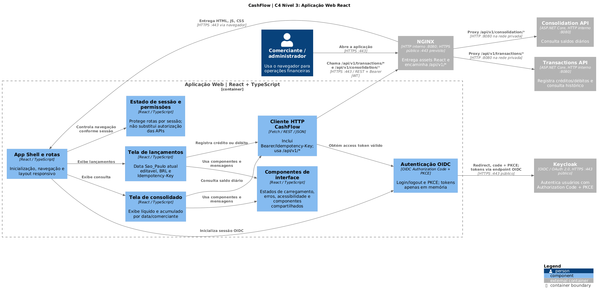

# Visão de Blocos de Construção (Building Block View)

> **Issue #6 · Milestone M2** | Arquitetura proposta

Esta visão mostra **de que partes o CashFlow é composto** e o papel de cada uma. Os diagramas utilizam o **C4 Model** com PlantUML.

## C4 Nível 1: Contexto

O **Comerciante** usa o CashFlow para registrar lançamentos e consultar saldos. O **Administrador de acessos** gerencia usuários e permissões. Ambos utilizam a aplicação Web React definida na ADR-007; o C4 de Contexto apresenta o CashFlow como um único sistema e deixa os detalhes internos para o Nível 2. As duas interações indicam **HTTPS/TCP 443 como porta pública prevista**, não como infraestrutura TLS já implantada.


[Fonte PlantUML](plantuml/c4-context.puml)

> **Atualização da imagem:** após alterações de portas na fonte, regenerar `images/c4-context.png` para que o PNG exibido nesta página reflita o protocolo HTTPS/TCP :443.

## C4 Nível 2: Contêineres

A **solução completa proposta** contém uma aplicação React responsiva, NGINX como reverse proxy definido para implementação no MVP, os **dois serviços financeiros independentes** (Lançamentos e Consolidado diário), o Keycloak como provedor de identidade, bancos separados por domínio, mensageria e coleta de observabilidade. O worker Outbox continua interno ao serviço de lançamentos. **O React faz login diretamente no Keycloak; o NGINX encaminha o Bearer token e cada API valida JWT localmente com chaves JWKS obtidas sob demanda ou em cache.** O diagrama também mostra uma **integração NGINX → Keycloak opcional e futura**, que exigiria um adaptador de autenticação (por exemplo, `auth_request`); **essa integração não existe no template atual nem substitui a validação dos backends**.


[Fonte PlantUML](plantuml/c4-containers.puml)

> **Renderização pendente:** a fonte C4 Nível 2 foi atualizada para React + TypeScript e NGINX. Regenerar `images/c4-containers.png` para apresentar as portas, o token encaminhado pelo NGINX e a obtenção de JWKS por cada backend no PNG. O papel de API Gateway dedicado e o BFF são evoluções futuras, conforme [ADR-007](adr/ADR-007-clients-api-gateway.md). A [ADR-008](adr/ADR-008-observability.md) está **decidida**: OpenTelemetry Collector, Prometheus, Loki, Tempo e Grafana. A imagem do C4 precisa ser atualizada após alteração da fonte.

| Bloco | Responsabilidade |
| --- | --- |
| Aplicação React (arquitetura-alvo) | React + TypeScript responsivo como cliente Web; aplicativo nativo não previsto no MVP. |
| NGINX (reverse proxy do MVP) | Serve a interface React e encaminha chamadas HTTP para as APIs no fluxo Web; não representa uma plataforma de API Gateway dedicada. Um Gateway com políticas adicionais fica para evolução futura. |
| Serviço de lançamentos (API + Outbox worker) | Receber e confirmar movimentações; publicar eventos pendentes em segundo plano. |
| Banco de lançamentos | Guardar lançamentos e eventos Outbox; manter trilha de auditoria proposta no mesmo domínio. |
| Mensageria | Entregar eventos ao serviço de consolidado. |
| Serviço de consolidado | Atualizar a visão diária e responder consultas de saldo. |
| Banco do consolidado | Guardar resultados calculados e eventos já processados. |
| Keycloak (provedor IAM adotado) | Gerenciar identidades, autenticação, sessões, emissão de tokens e chaves públicas OIDC/JWKS. Não concentra necessariamente os vínculos de negócio dos comerciantes. |
| Banco do Keycloak | Persistir usuários, credenciais protegidas, clientes OIDC e configurações do provedor. A autorização por comerciante é responsabilidade do CashFlow. |
| OpenTelemetry Collector | Receber e encaminhar os sinais OTLP produzidos pelas APIs e workers. |
| Prometheus | Armazenar e consultar métricas, coletadas por scraping de endpoints compatíveis. |
| Loki | Centralizar logs estruturados, com ingestão OTLP/HTTP configurada. |
| Tempo | Armazenar traces distribuídos de fluxos HTTP e assíncronos. |
| Grafana | Dashboards e consulta dos três backends, com data sources configurados. |

**Nota:** a interface escolhida é uma aplicação Web React responsiva; **não há aplicativo mobile nativo no MVP** (ADR-007).

## Protocolos e portas de referência

Os números são **portas de destino**, não portas de origem. NGINX :8080 está **confirmado no template** [default.conf.template](../../infra/nginx/default.conf.template); portas das APIs :8080 são **exemplos dos upstreams** documentados. HTTPS público :443 e os serviços não implementados são **premissas a confirmar na implantação**, não configuração validada do AKS.

| Origem → destino | Protocolo | Porta de destino | Condição |
| --- | --- | --- | --- |
| Navegador → borda pública | HTTPS/TCP | **443** | Prevista com TLS; porta externa ainda não configurada |
| Borda / Ingress → NGINX | HTTP/TCP | **8080** | Confirmada no template NGINX |
| NGINX → Transactions | HTTP/TCP | **8080** | Exemplo `transactions:8080`, rede privada |
| NGINX → Consolidation | HTTP/TCP | **8080** | Exemplo `consolidation:8080`, rede privada |
| Navegador → Keycloak | OIDC/HTTPS | **443** | URL pública e terminação TLS a definir |
| APIs → JWKS Keycloak | HTTPS/TCP | **443** | Endpoint externo/privado conforme implantação; cache local |
| NGINX → integração IAM opcional | HTTPS/TCP | **443** | **Futura, não implementada**: `auth_request` com adaptador OIDC ou solução equivalente; não é login obrigatório no fluxo atual |
| NGINX → APIs financeiras | HTTP/TCP | **8080** | Preserva `Authorization: Bearer`; o NGINX não valida JWT no template atual |
| Keycloak → banco de identidade | PostgreSQL/TCP | **5432** | Porta-padrão, privada |
| APIs → bancos lógicos próprios | PostgreSQL/TCP | **5432** | Porta-padrão, privada |
| Transactions Outbox → RabbitMQ | AMQP/TCP | **5672** | Porta-padrão sem TLS; AMQPS/TLS: **5671** |
| Consolidation Consumer → RabbitMQ | AMQP/TCP | **5672** | Consumer inicia a conexão com o broker; não abre listener AMQP próprio |
| APIs/workers → OpenTelemetry Collector | OTLP/gRPC ou HTTP | **4317 / 4318** | Conforme transporte configurado |
| Collector → Prometheus | Exporter HTTP / scrape | **a definir** | Exemplo configurável: 8889, não assumido como implantado |
| Collector → Loki | OTLP/HTTP | **3100** | Porta de ingestão usual, configuração pendente |
| Collector → Tempo | OTLP/gRPC ou HTTP | **4317 / 4318** | Porta no contêiner Tempo, independente do Collector |
| Grafana → Prometheus | HTTP | **9090** | Porta usual de consulta, privada |
| Grafana → Loki | HTTP | **3100** | Porta usual de consulta, privada |
| Grafana → Tempo | HTTP | **3200** | Porta usual de consulta, privada |
| Navegador → Grafana (se exposto) | HTTPS | **443** | Serviço interno costuma escutar em 3000; exposição opcional |

**O React não escuta porta TCP**: seus arquivos são servidos pelo NGINX e o JavaScript roda no navegador. O template NGINX atual escuta **HTTP em 8080**, não HTTPS. TLS público na porta 443 precisa ser configurado no Ingress/borda; não assumir HTTPS no salto NGINX → APIs até que seja implementado. O broker AMQP/5672 deve ficar privado; habilitar TLS e 5671 se exigido.

## Escopo: desafio x solução completa

| Elemento | Situação |
| --- | --- |
| Registro de créditos e débitos | **Exigido pelo desafio** |
| Consulta ao consolidado diário | **Exigido pelo desafio** |
| Independência entre registro e consolidação | **Exigida pelo desafio** |
| Interfaces Web/Mobile e painel administrativo | **Proposta de solução completa**, não exigida |
| NGINX / API Gateway | **NGINX incluído no MVP como reverse proxy**; API Gateway dedicado é evolução futura, conforme ADR-007 |
| Keycloak e seu banco | **Escolha arquitetural decidida (ADR-006)**; implantação e administração completas podem ficar fora do MVP financeiro |
| Mensageria, Outbox e observabilidade | **Decisões de arquitetura propostas** para atender resiliência e operação |

A implementação planejada do MVP inclui NGINX no caminho Web e mantém o foco funcional nas duas APIs e no processamento financeiro; a infraestrutura completa ainda precisa ser integrada e testada. Isso evita confundir a apresentação com uma promessa de implementar todas as interfaces.

## Autenticação, autorização e validação de JWT

A interface Web/Mobile autentica usuários no **Keycloak**, utilizando **OpenID Connect (OIDC) sobre HTTPS**. Para clientes públicos, a direção é Authorization Code com PKCE; o armazenamento seguro de tokens, eventual BFF, MFA e detalhes por plataforma serão definidos nas Issues #7 e #9. Não será desenvolvido um servidor próprio para emissão de tokens.

As APIs de **Lançamentos** e **Consolidado** devem validar os JWTs **localmente**, verificando assinatura, emissor, audiência, validade e permissões. As chaves públicas do Keycloak podem ser obtidas por **JWKS/HTTPS** e mantidas em cache conforme a política de rotação e expiração. Assim, com tokens e chaves válidos, o registro financeiro não precisa chamar o IAM sincronicamente a cada operação.

**Keycloak autentica; as APIs do CashFlow autorizam.** O NGINX não substitui esses controles. A verificação de acesso também deve considerar o `merchant_id` autorizado. Uma role como `VIEWER` não concede, por si só, acesso aos dados de outros comerciantes. Política de revogação, propagação de mudanças de permissões e acessos administrativos serão detalhados na Issue #9.

## Telemetria e observabilidade

Os serviços de **Lançamentos** e **Consolidado** são prioritários para instrumentação. **Keycloak**, o NGINX e um eventual **API Gateway futuro** poderão emitir telemetria quando forem implantados e configurados. O C4 apresenta o pipeline em um bloco de plataforma, com seus componentes listados na documentação, para evitar linhas transversais em excesso.

| Sinal | Uso esperado |
| --- | --- |
| **Logs estruturados** | Diagnóstico de erros, tentativas de acesso e processamento, sem expor tokens, senhas ou dados financeiros sensíveis. |
| **Métricas** | Taxa de requisições, erros, latência, eventos pendentes na Outbox, tamanho das filas e atraso da consolidação. |
| **Traces distribuídos** | Acompanhar operações que passam por NGINX, APIs, mensageria e consumidor, propagando contexto de rastreamento. |

Conforme a **ADR-008 decidida**, OpenTelemetry instrumenta serviços .NET, OpenTelemetry Collector recebe/encaminha os sinais, **Prometheus** armazena métricas, **Loki** armazena logs, **Tempo** armazena traces e **Grafana** oferece dashboards. Alertas, retenção, volumes, segurança e HA serão detalhados na ADR-009 e nas issues operacionais. A coleta de componentes de terceiros exige exporters/agentes próprios quando aplicável. A falha na stack de observabilidade não pode bloquear a confirmação de lançamentos. A trilha de **auditoria financeira persistida** não é substituída por logs de aplicação.

## Controle de acesso e decisão de tecnologia

Os perfis `ADMIN`, `OPERATOR` e `VIEWER` são exemplos para discussão. O cadastro de usuários, as relações com comerciantes e os fluxos de aprovação ainda precisam ser refinados nos requisitos funcionais. A **ADR-006 escolhe Keycloak** para identidade e autenticação. As relações usuário/comerciante e as permissões financeiras continuam sob a responsabilidade do CashFlow, sem exigir um novo servidor próprio de autenticação. A forma de persistir e consultar esses vínculos será detalhada na Issue #9. A Issue #9 detalhará MFA, auditoria, segregação por comerciante, tratamento de segredos, expiração e revogação de acesso.

A indisponibilidade do Keycloak **não deve parar o registro de movimentações que já tenham token válido**, desde que a validação local e as políticas de acesso permitam. Essa condição precisa ser testada.

## C4 Nível 3: Componentes

Os três diagramas abaixo detalham **Frontend React**, **Transactions** e **Consolidation**, em continuidade direta com os Níveis 1 e 2. As imagens devem usar os nomes `c4-components-frontend.png`, `c4-components-transactions.png` e `c4-components-consolidation.png` na pasta `docs/architecture/images/`. A documentação inclui detalhes que foram retirados das caixas amarelas para simplificar as imagens.

### Objetivo e fronteiras

Esta seção C4 Nível 3 detalha **componentes dentro de um contêiner do C4 Nível 2**, não adiciona microsserviços novos. Por isso existem **três diagramas**, um para React, um para `Transactions` e outro para `Consolidation`. Os componentes são responsabilidades lógicas que podem corresponder a classes ou conjuntos de classes em projetos .NET, não necessariamente a processos, bibliotecas ou deploys independentes.

Para os serviços .NET, a organização segue a [ADR-002](adr/ADR-002-architecture-style-clean-architecture.md): projetos `Domain`, `Application`, `Infrastructure` e `Api` por serviço; dependências de código apontam para o núcleo, e `Api` atua como *composition root*. **Setas nos diagramas representam interações em tempo de execução**, não o grafo de referências de assembly.

As representações dos serviços financeiros mantêm PostgreSQL, RabbitMQ, Keycloak/NGINX e OpenTelemetry Collector como **contêineres externos ao limite dos componentes de cada serviço**. No ambiente Azure, PostgreSQL Flexible Server pode ser o mesmo servidor físico para vários bancos lógicos, mas a propriedade dos dados continua segregada por domínio. Nenhum serviço financeiro lê o banco do outro.

### Frontend React e TypeScript



**[Fonte PlantUML editável](plantuml/c4-components-frontend.puml)**

| Componente | Responsabilidade |
| --- | --- |
| App Shell e rotas | Navegação, layout responsivo e inicialização |
| Autenticação OIDC | Login/logout via Keycloak com Authorization Code + PKCE, callback e controle de tokens |
| Estado de sessão e permissões | Experiência de navegação conforme sessão, sem substituir autorização das APIs |
| Tela de lançamentos | Formulários de crédito/débito e feedback da operação |
| Tela de consolidado | Consulta de saldos diários e estados de carregamento/erro |
| Cliente HTTP | Chamadas REST a `/api/transactions/*` e `/api/consolidation/*` com access token |
| Componentes de interface | Elementos reutilizáveis, validações visuais e acessibilidade |

**Portas e execução:** React é uma SPA executada no navegador e **não abre porta TCP própria**. O NGINX serve seu build estático e encaminha APIs, escutando **HTTP interno :8080** no [template atual](../../infra/nginx/default.conf.template). A entrada HTTPS pública **:443** é uma premissa de implantação futura. O login comunica diretamente com Keycloak por OIDC/HTTPS. Não há BFF nem mobile nativo no MVP (ADR-007).

**Segurança:** proteger rotas no React é apenas UX. Ambas as APIs devem validar JWT e autorização por `merchant_id` no backend. Não armazenar tokens em `localStorage`.

### Transactions, API de lançamentos e Outbox


**[Fonte PlantUML editável](plantuml/c4-components-transactions.puml)**

| Componente lógico | Responsabilidade |
| --- | --- |
| Endpoints / API Host | Receber chamadas REST, validar tokens no limite, mapear comandos, executar DI/health checks |
| Autorização por comerciante | Verificar a associação autorizada entre sujeito autenticado e `merchant_id`; persistência e regras administrativas ainda a detalhar |
| Registrar lançamento (Application) | Orquestrar crédito/débito, invariantes e persistência transacional |
| Modelo financeiro (Domain) | Entidades, value objects, cálculos e regras de negócio puras |
| Portas (Application) | Contratos necessários aos repositórios, unidade de trabalho e publicação |
| Repositórios + Unit of Work (Infrastructure) | Persistir `Transaction` e `OutboxEvent` atomicamente por EF Core |
| Outbox BackgroundService | Recolher eventos pendentes e conduzir retentativas sem bloquear o endpoint de registro |
| RabbitMQ Publisher (Infrastructure) | Publicar eventos por AMQP com *publisher confirms* |

**Fluxo essencial:** NGINX → API → autorização → caso de uso → domínio + repositórios → commit de `Transaction` e `OutboxEvent`. **Só depois**, de modo assíncrono, o worker Outbox busca registros pendentes e publica no RabbitMQ. Consolidation não participa da confirmação HTTP de um lançamento.

A ADR-002 permite que o `BackgroundService` seja registrado no mesmo processo host que a API. Portanto, **o worker Outbox é um componente de Transactions, não um terceiro microsserviço**. Se for necessário separá-lo em processo no futuro, a propriedade do evento e do banco permanece com Transactions.

### Consolidation, consumidor e consulta do consolidado


**[Fonte PlantUML editável](plantuml/c4-components-consolidation.puml)**

| Componente lógico | Responsabilidade |
| --- | --- |
| Endpoints de consulta | Receber consultas REST, validar tokens e delegar busca do saldo |
| Autorização por comerciante | Autorizar consultas no contexto de `merchant_id` |
| Consultar saldo diário (Application) | Recuperar projeções do banco próprio, sem chamada para Transactions |
| RabbitMQ Consumer (Host / Infrastructure) | Consumir mensagem, chamar o caso de uso e enviar ACK apenas após sucesso |
| Processar lançamento (Application) | Aplicar regras e garantir idempotência por `event_id` |
| Modelo de consolidação (Domain) | Manter invariantes e regra de agregação diária |
| Portas de projeção e deduplicação | Contratos para leitura de projeções e gravação atômica |
| Repositórios + Unit of Work | Ler `DailyBalance`; gravar `DailyBalance` e `ProcessedEvent` na mesma transação |

**Fluxo de evento:** RabbitMQ → consumidor → caso de uso → regra de domínio + repositório → commit transacional de `DailyBalance` e `ProcessedEvent` → ACK. Um `event_id` já aplicado não pode alterar novamente o saldo, mesmo após reentrega.

**Fluxo de consulta:** NGINX → API → autorização → caso de uso de consulta → banco de Consolidation. A consulta deve ser independente do banco e da disponibilidade de Transactions; a visão pode estar temporariamente desatualizada pela consistência eventual.

### Regras transversais preservadas

- **Identidade:** Keycloak autentica e emite JWT; as APIs validam assinatura, issuer, audience e validade localmente a partir de chaves JWKS cacheadas. A autorização por comerciante é responsabilidade do CashFlow, não uma concessão implícita de qualquer JWT válido.
- **Observabilidade:** componentes emitem métricas, traces e logs via OpenTelemetry/OTLP; a falha do Collector não deve interromper o registro financeiro. Auditoria persistente é distinta de telemetria.
- **Persistência:** `Transaction` + `OutboxEvent` no mesmo commit, e `DailyBalance` + `ProcessedEvent` no mesmo commit, conforme ADR-005.
- **Contratos:** a comunicação entre serviços financeiros ocorre por eventos versionáveis no RabbitMQ; nenhuma dependência síncrona de Transactions para Consolidation no registro.
- **Fronteira não fechada:** localização da persistência de `Merchant`/`Membership`, política exata de permissões, regra do saldo diário, estornos e algumas convenções de retries/DLQ seguem os documentos de requisitos e issues em aberto. Os componentes indicam responsabilidades, **não tabelas ou classes definitivas**.

### Como renderizar os diagramas

As três fontes usam a biblioteca **C4-PlantUML** (`!include <C4/C4_Component>`). Em um ambiente com PlantUML instalado e suporte à biblioteca:

```bash
plantuml -tpng docs/architecture/plantuml/c4-components-frontend.puml
plantuml -tpng docs/architecture/plantuml/c4-components-transactions.puml
plantuml -tpng docs/architecture/plantuml/c4-components-consolidation.puml
```

As imagens acima devem ser colocadas em `docs/architecture/images/` com os nomes `c4-components-frontend.png`, `c4-components-transactions.png` e `c4-components-consolidation.png`. **As fontes PlantUML são a referência editável**. Os links de imagem funcionarão após adicionar os PNGs ao repositório.

### Protocolos e portas de destino

A tabela completa está na [Building Block View](building-block-view.md#protocolos-e-portas-de-referência). Nos diagramas Nível 3 foram identificadas as principais portas: **443** (HTTPS de entrada previsto), **8080** (NGINX interno confirmado, APIs como exemplo), **5432** (PostgreSQL), **5672** (AMQP privado, ou **5671** com TLS) e **4317/4318** (OTLP, conforme transporte). As portas-padrão não são garantia de configuração implantada; todo acesso público além do HTTPS previsto depende de decisão de segurança e infraestrutura.

### Observações que saíram dos diagramas

As notas amarelas foram retiradas apenas para melhorar a legibilidade, sem eliminar as decisões técnicas:

- **Frontend:** React não abre uma porta de servidor própria. O NGINX serve o build estático, e o JavaScript roda no navegador. O template atual do NGINX escuta HTTP interno em **8080**; **HTTPS público em 443** depende da configuração de Ingress/TLS no AKS. A SPA não deve guardar tokens em `localStorage` e não substitui a autorização do backend.
- **Transactions:** Keycloak autentica, mas o acesso por `merchant_id` pertence às APIs CashFlow. O armazenamento do vínculo ainda depende de definição. O Outbox worker pertence ao serviço Transactions, pode compartilhar o host da API e nunca precisa aguardar Consolidation para confirmar o lançamento.
- **Consolidation:** o banco de Transactions **não** é consultado diretamente. O saldo pode ficar temporariamente desatualizado. A deduplicação por `event_id` e a atualização de `DailyBalance` devem ocorrer na mesma transação para impedir contagem dupla.

## Próximas leituras

- [Diagramas de sequência](sequence-diagrams.md), para ver as interações passo a passo.
- [Casos de Uso](use-cases.md), para entender as ações do comerciante e os fluxos de negócio.
- [Modelo de Dados](data-model.md), para entender os registros financeiros, a Outbox, a projeção e a auditoria.
