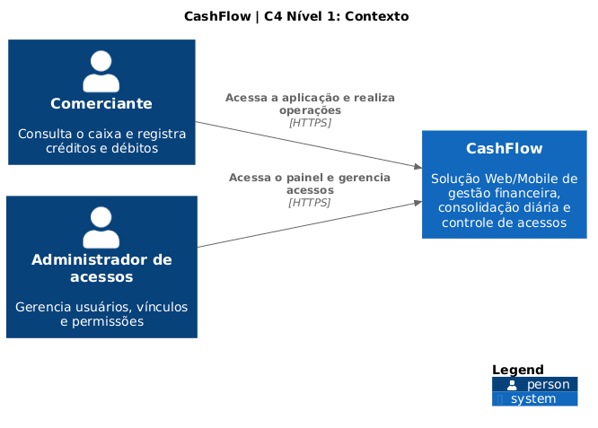

# Visão de Blocos de Construção (Building Block View)

> **Issue #6 · Milestone M2** | Arquitetura proposta

Esta visão mostra **de que partes o CashFlow é composto** e o papel de cada uma. Os diagramas utilizam o **C4 Model** com PlantUML.

## C4 Nível 1: Contexto

O **Comerciante** usa o CashFlow para registrar lançamentos e consultar saldos. O **Administrador de acessos** gerencia usuários e permissões. Ambos utilizam a aplicação Web/Mobile proposta; o C4 de Contexto apresenta o CashFlow como um único sistema e deixa os detalhes internos para o Nível 2.

[Fonte PlantUML](plantuml/c4-context.puml)

## C4 Nível 2: Contêineres

A **solução completa proposta** contém uma aplicação React responsiva, NGINX como reverse proxy obrigatório no MVP, os **dois serviços financeiros independentes** (Lançamentos e Consolidado diário), o Keycloak como provedor de identidade, bancos separados por domínio, mensageria e coleta de observabilidade. O worker Outbox continua interno ao serviço de lançamentos.

[Fonte PlantUML](plantuml/c4-containers.puml)

> **Renderização pendente:** a fonte C4 Nível 2 foi atualizada para React + TypeScript e NGINX. Regenerar `images/c4-containers.png`. O papel de API Gateway dedicado e o BFF são evoluções futuras, conforme [ADR-007](adr/ADR-007-clients-api-gateway.md). A [ADR-008](adr/ADR-008-observability.md) está em revisão para a estratégia de observabilidade.

| Bloco | Responsabilidade |
| --- | --- |
| Aplicação React (arquitetura-alvo) | React + TypeScript responsivo como cliente Web; aplicativo nativo não previsto no MVP. |
| NGINX (reverse proxy do MVP) | Serve a interface React e encaminha chamadas HTTP para as APIs no fluxo Web; não representa uma plataforma de API Gateway dedicada. Um Gateway com políticas adicionais fica para evolução futura. |
| Serviço de lançamentos (API + Outbox worker) | Receber e confirmar movimentações; publicar eventos pendentes em segundo plano. |
| Banco de lançamentos | Guardar lançamentos e eventos Outbox; manter trilha de auditoria proposta no mesmo domínio. |
| Mensageria | Entregar eventos ao serviço de consolidado. |
| Serviço de consolidado | Atualizar a visão diária e responder consultas de saldo. |
| Banco do consolidado | Guardar resultados calculados e eventos já processados. |
| Keycloak (provedor IAM adotado) | Gerenciar identidades, autenticação, sessões, emissão de tokens e chaves públicas OIDC/JWKS. Não concentra necessariamente os vínculos de negócio dos comerciantes. |
| Banco do Keycloak | Persistir usuários, credenciais protegidas, clientes OIDC e configurações do provedor. A autorização por comerciante é responsabilidade do CashFlow. |
| Coleta de observabilidade | Receber informações de diagnóstico e desempenho dos serviços. |

**Nota:** o bloco Web/Mobile é uma representação conceitual dos canais de entrada. Se forem aplicações implantadas separadamente, o C4 Nível 2 pode ser desdobrado em contêiner Web e contêiner Mobile após a escolha tecnológica na Issue #7.

## Protocolos propostos

| Comunicação | Protocolo |
| --- | --- |
| Usuários → aplicação Web/Mobile | HTTPS |
| React → NGINX | HTTPS / REST / JSON, com Bearer JWT |
| NGINX → APIs financeiras | Proxy HTTPS / REST / JSON; autenticação OIDC com Keycloak ocorre separadamente |
| Login e identificação | Keycloak com OpenID Connect / OAuth 2.0 sobre HTTPS; Authorization Code + PKCE conforme tipo de cliente |
| Cadastro, grupos e permissões | API administrativa REST / HTTPS (proposta) |
| Validação de JWT | JWKS / HTTPS, com validação local e cache das chaves |
| APIs e seus bancos | SQL / TCP, com proteção de conexão |
| Worker Outbox → broker → consumidor | AMQP 0-9-1 |
| Serviços → observabilidade | OTLP / gRPC e logs estruturados |

Os protocolos representam **propostas**, não decisões finais. Produtos e garantias serão formalizados nos ADRs da Issue #7. As APIs devem validar assinatura, emissor, audiência, prazo e permissões do token. A autorização também precisa verificar que o usuário possui acesso ao **comerciante/conta consultada**, e não somente que pertence a determinado grupo. Tokens podem ter permissões desatualizadas até sua expiração; revogação e política de atualização serão detalhadas na Issue #9.

## Escopo: desafio x solução completa

| Elemento | Situação |
| --- | --- |
| Registro de créditos e débitos | **Exigido pelo desafio** |
| Consulta ao consolidado diário | **Exigido pelo desafio** |
| Independência entre registro e consolidação | **Exigida pelo desafio** |
| Interfaces Web/Mobile e painel administrativo | **Proposta de solução completa**, não exigida |
| NGINX / API Gateway | **NGINX incluído no MVP como reverse proxy**; API Gateway dedicado é evolução futura, conforme ADR-007 |
| Keycloak e seu banco | **Escolha arquitetural aceita (ADR-006)**; implantação e administração completas podem ficar fora do MVP financeiro |
| Mensageria, Outbox e observabilidade | **Decisões de arquitetura propostas** para atender resiliência e operação |

O MVP de código pode focar as APIs e o processamento financeiro, enquanto o desenho-alvo documenta a evolução da aplicação. Isso evita confundir a apresentação com uma promessa de implementar todas as interfaces.

## Autenticação, autorização e validação de JWT

A interface Web/Mobile autentica usuários no **Keycloak**, utilizando **OpenID Connect (OIDC) sobre HTTPS**. Para clientes públicos, a direção é Authorization Code com PKCE; o armazenamento seguro de tokens, eventual BFF, MFA e detalhes por plataforma serão definidos nas Issues #7 e #9. Não será desenvolvido um servidor próprio para emissão de tokens.

As APIs de **Lançamentos** e **Consolidado** devem validar os JWTs **localmente**, verificando assinatura, emissor, audiência, validade e permissões. As chaves públicas do Keycloak podem ser obtidas por **JWKS/HTTPS** e mantidas em cache conforme a política de rotação e expiração. Assim, com tokens e chaves válidos, o registro financeiro não precisa chamar o IAM sincronicamente a cada operação.

**Keycloak autentica; as APIs do CashFlow autorizam.** O NGINX não substitui esses controles. A verificação de acesso também deve considerar o `merchant_id` autorizado. Uma role como `VIEWER` não concede, por si só, acesso aos dados de outros comerciantes. Política de revogação, propagação de mudanças de permissões e acessos administrativos serão detalhados na Issue #9.

## Telemetria e observabilidade

Os serviços de **Lançamentos** e **Consolidado** são prioritários para instrumentação. **Keycloak**, o NGINX e um eventual **API Gateway futuro** poderão emitir telemetria quando forem implantados e configurados. O desenho simplificado representa essa integração como uma nota para evitar cruzamento de linhas.

| Sinal | Uso esperado |
| --- | --- |
| **Logs estruturados** | Diagnóstico de erros, tentativas de acesso e processamento, sem expor tokens, senhas ou dados financeiros sensíveis. |
| **Métricas** | Taxa de requisições, erros, latência, eventos pendentes na Outbox, tamanho das filas e atraso da consolidação. |
| **Traces distribuídos** | Acompanhar operações que passam por proxy opcional, APIs, mensageria e consumidor, propagando contexto de rastreamento. |

**OTLP** é o protocolo proposto para exportação dos sinais; **OpenTelemetry** é a opção de instrumentação/coleta. A escolha de armazenamento, dashboards, alertas e regras de retenção será formalizada nas próximas issues. A trilha de **auditoria financeira persistida** não é substituída por logs de aplicação.

## Controle de acesso e decisão de tecnologia

Os perfis `ADMIN`, `OPERATOR` e `VIEWER` são exemplos para discussão. O cadastro de usuários, as relações com comerciantes e os fluxos de aprovação ainda precisam ser refinados nos requisitos funcionais. A **ADR-006 escolhe Keycloak** para identidade e autenticação. As relações usuário/comerciante e as permissões financeiras continuam sob a responsabilidade do CashFlow, sem exigir um novo servidor próprio de autenticação. A forma de persistir e consultar esses vínculos será detalhada na Issue #9. A Issue #9 detalhará MFA, auditoria, segregação por comerciante, tratamento de segredos, expiração e revogação de acesso.

A indisponibilidade do Keycloak **não deve parar o registro de movimentações que já tenham token válido**, desde que a validação local e as políticas de acesso permitam. Essa condição precisa ser testada.

## Evolução para C4 Nível 3

Se for útil à avaliação, uma futura visão de componentes pode detalhar **API, aplicação de negócio, persistência e Outbox worker** dentro do serviço de lançamentos; consumidor e consulta no serviço de consolidado; e configuração do Keycloak e autorização por comerciante nos serviços de negócio. Só acrescentaremos níveis adicionais quando contribuírem para explicar decisões importantes.

## Próximas leituras

- [Diagramas de sequência](sequence-diagrams.md), para ver as interações passo a passo.
- [Casos de Uso](use-cases.md), para entender as ações do comerciante e os fluxos de negócio.
- [Modelo de Dados](data-model.md), para entender os registros financeiros, a Outbox, a projeção e a auditoria.
