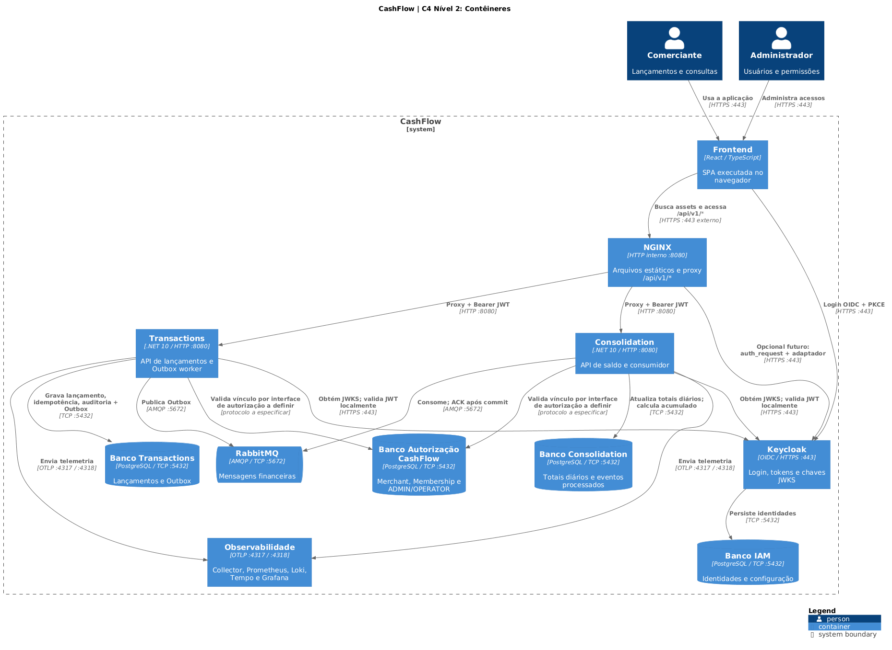

# Visão de Blocos de Construção (Building Block View)

> **Issue #6 · Milestone M2** | Arquitetura proposta

Esta visão mostra **de que partes o CashFlow é composto** e o papel de cada uma. Os diagramas utilizam o **C4 Model** com PlantUML.

## C4 Nível 1: Contexto

O **Comerciante** usa o CashFlow para registrar lançamentos e consultar saldos. O **Administrador de acessos** gerencia usuários e permissões. Ambos utilizam a aplicação web proposta; o C4 de Contexto apresenta o CashFlow como um único sistema e deixa os detalhes internos para o Nível 2.

[Fonte PlantUML](plantuml/c4-context.puml)

> **Imagem pendente de atualização:** o arquivo PNG ainda representa a versão anterior. Renderize novamente o `.puml`.

## C4 Nível 2: Contêineres

A **solução completa proposta** contém uma Aplicação Web, um API Gateway, os **dois serviços financeiros independentes** (Lançamentos e Consolidado diário), um serviço transversal de Identidade e Acessos (IAM), bancos separados por domínio, mensageria e coleta de observabilidade. O worker Outbox continua interno ao serviço de lançamentos.

[Fonte PlantUML](plantuml/c4-containers.puml)

> **Imagem pendente de atualização:** o arquivo PNG ainda representa a versão anterior. Renderize novamente o `.puml`.

| Bloco | Responsabilidade |
| --- | --- |
| Aplicação Web (SPA proposta) | Interface para comerciantes e administradores, formulários, consultas e apresentação de erros. |
| API Gateway (proposto) | Ponto de entrada para APIs, roteamento e controles de borda; não substitui autorização nos serviços. |
| Serviço de lançamentos (API + Outbox worker) | Receber e confirmar movimentações; publicar eventos pendentes em segundo plano. |
| Banco de lançamentos | Guardar lançamentos e eventos Outbox; manter trilha de auditoria proposta no mesmo domínio. |
| Mensageria | Entregar eventos ao serviço de consolidado. |
| Serviço de consolidado | Atualizar a visão diária e responder consultas de saldo. |
| Banco do consolidado | Guardar resultados calculados e eventos já processados. |
| Serviço de Identidade e Acessos (interno) | Centralizar login, cadastro, vínculos de usuários aos comerciantes, grupos e papéis; disponibilizar material público para validação de tokens. |
| Banco de identidade e acessos | Armazenar usuários, grupos, vínculos e permissões, com mecanismos seguros para informações de autenticação. |
| Coleta de observabilidade | Receber informações de diagnóstico e desempenho dos serviços. |

## Protocolos propostos

| Comunicação | Protocolo |
| --- | --- |
| Usuários → aplicação web | HTTPS |
| Aplicação web → API Gateway | HTTPS / REST / JSON, com Bearer JWT |
| Gateway → serviços de negócio/IAM | HTTPS / REST / JSON |
| Login e identificação | OpenID Connect / OAuth 2.0 sobre HTTPS (proposto) |
| Cadastro, grupos e permissões | API administrativa REST / HTTPS (proposta) |
| Validação de JWT | JWKS / HTTPS, com validação local e cache das chaves |
| APIs e seus bancos | SQL / TCP, com proteção de conexão |
| Worker Outbox → broker → consumidor | AMQP 0-9-1 |
| Serviços → observabilidade | OTLP / gRPC e logs estruturados |

Os protocolos representam **propostas**, não decisões finais. Produtos e garantias serão formalizados nos ADRs da Issue #7. As APIs devem validar assinatura, emissor, audiência, prazo e permissões do token. A autorização também precisa verificar que o usuário possui acesso ao **comerciante/conta consultada**, e não somente que pertence a determinado grupo. Tokens podem ter permissões desatualizadas até sua expiração; revogação e política de atualização serão detalhadas na Issue #9.

## Escopo: desafio x solução completa

| Elemento | Situação |
| --- | --- |
| Registro de créditos e débitos | **Exigido pelo desafio** |
| Consulta ao consolidado diário | **Exigido pelo desafio** |
| Independência entre registro e consolidação | **Exigida pelo desafio** |
| Frontend SPA e painel administrativo | **Proposta de solução completa**, não exigida |
| API Gateway | **Proposta**, avaliar necessidade e custo |
| Serviço IAM e banco próprio | **Proposta**, dependente da estratégia de identidade |
| Mensageria, Outbox e observabilidade | **Decisões de arquitetura propostas** para atender resiliência e operação |

O MVP de código pode focar as APIs e o processamento financeiro, enquanto o desenho-alvo documenta a evolução da aplicação. Isso evita confundir a apresentação com uma promessa de implementar todas as interfaces.

## Controle de acesso e decisão de tecnologia

Os perfis `ADMIN`, `OPERATOR` e `VIEWER` são exemplos para discussão. O cadastro de usuários, as relações com comerciantes e os fluxos de aprovação ainda precisam ser refinados nos requisitos funcionais. Não devemos implementar autenticação caseira: a Issue #7 avaliará a adoção de um mecanismo IAM maduro, possivelmente encapsulado pelo serviço interno, para login, protocolos, proteção de credenciais e tokens. A Issue #9 detalhará MFA, auditoria, segregação por comerciante, tratamento de segredos, expiração e revogação de acesso.

A indisponibilidade do IAM **não deve parar o registro de movimentações que já tenham token válido**, desde que a validação local e as políticas de acesso permitam. Essa condição precisa ser testada.

## Evolução para C4 Nível 3

Se for útil à avaliação, uma futura visão de componentes pode detalhar **API, aplicação de negócio, persistência e Outbox worker** dentro do serviço de lançamentos; consumidor e consulta no serviço de consolidado; e gestão de usuários, vínculos e grupos no IAM. Só acrescentaremos níveis adicionais quando contribuírem para explicar decisões importantes.

## Próximas leituras

- [Diagramas de sequência](sequence-diagrams.md), para ver as interações passo a passo.
- [Casos de Uso](use-cases.md), para entender as ações do comerciante e os fluxos de negócio.
- [Modelo de Dados](data-model.md), para entender os registros financeiros, a Outbox, a projeção e a auditoria.
