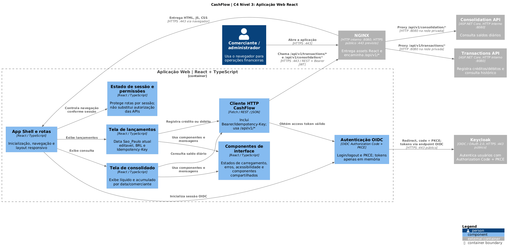
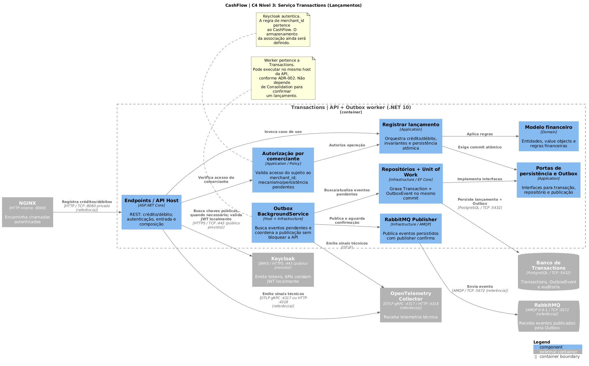
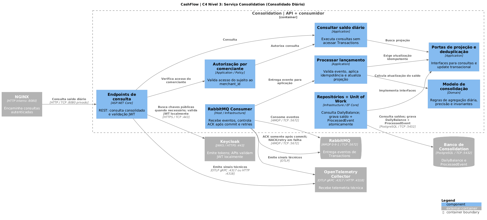

# C4 Nível 3: Componentes do frontend e dos serviços financeiros

> **Issue #6 · Milestone M2** | **Estado:** arquitetura-alvo documentada, implementação não verificada  
> **Referências:** [Building Block View](building-block-view.md), [ADR-002](adr/ADR-002-architecture-style-clean-architecture.md), [ADR-003](adr/ADR-003-persistence.md), [ADR-004](adr/ADR-004-async-messaging.md), [ADR-005](adr/ADR-005-outbox-consistency-idempotency.md), [ADR-006](adr/ADR-006-identity-and-access.md)

## Objetivo e fronteiras

O C4 Nível 3 detalha **componentes dentro de um contêiner do C4 Nível 2**, não adiciona microsserviços novos. Por isso existem **três diagramas**, um para React, um para `Transactions` e outro para `Consolidation`. Os componentes são responsabilidades lógicas que podem corresponder a classes ou conjuntos de classes em projetos .NET, não necessariamente a processos, bibliotecas ou deploys independentes.

Para os serviços .NET, a organização segue a [ADR-002](adr/ADR-002-architecture-style-clean-architecture.md): projetos `Domain`, `Application`, `Infrastructure` e `Api` por serviço; dependências de código apontam para o núcleo, e `Api` atua como *composition root*. **Setas nos diagramas representam interações em tempo de execução**, não o grafo de referências de assembly.

As representações dos serviços financeiros mantêm PostgreSQL, RabbitMQ, Keycloak/NGINX e OpenTelemetry Collector como **contêineres externos ao limite dos componentes de cada serviço**. No ambiente Azure, PostgreSQL Flexible Server pode ser o mesmo servidor físico para vários bancos lógicos, mas a propriedade dos dados continua segregada por domínio. Nenhum serviço financeiro lê o banco do outro.

## 1. Frontend React e TypeScript



**[Fonte PlantUML editável](plantuml/c4-components-frontend.puml)**

| Componente | Responsabilidade |
| --- | --- |
| App Shell e rotas | Navegação, layout responsivo e inicialização |
| Autenticação OIDC | Login/logout via Keycloak com Authorization Code + PKCE, callback e controle de tokens |
| Estado de sessão e permissões | Experiência de navegação conforme sessão, sem substituir autorização das APIs |
| Tela de lançamentos | Formulários de crédito/débito e feedback da operação |
| Tela de consolidado | Consulta de saldos diários e estados de carregamento/erro |
| Cliente HTTP | Chamadas REST a `/api/transactions/*` e `/api/consolidation/*` com access token |
| Componentes de interface | Elementos reutilizáveis, validações visuais e acessibilidade |

**Portas e execução:** React é uma SPA executada no navegador e **não abre porta TCP própria**. O NGINX serve seu build estático e encaminha APIs, escutando **HTTP interno :8080** no [template atual](../../infra/nginx/default.conf.template). A entrada HTTPS pública **:443** é uma premissa de implantação futura. O login comunica diretamente com Keycloak por OIDC/HTTPS. Não há BFF nem mobile nativo no MVP (ADR-007).

**Segurança:** proteger rotas no React é apenas UX. Ambas as APIs devem validar JWT e autorização por `merchant_id` no backend. Não armazenar tokens em `localStorage`.

## 2. Transactions, API de lançamentos e Outbox



**[Fonte PlantUML editável](plantuml/c4-components-transactions.puml)**

| Componente lógico | Responsabilidade |
| --- | --- |
| Endpoints / API Host | Receber chamadas REST, validar tokens no limite, mapear comandos, executar DI/health checks |
| Autorização por comerciante | Verificar a associação autorizada entre sujeito autenticado e `merchant_id`; persistência e regras administrativas ainda a detalhar |
| Registrar lançamento (Application) | Orquestrar crédito/débito, invariantes e persistência transacional |
| Modelo financeiro (Domain) | Entidades, value objects, cálculos e regras de negócio puras |
| Portas (Application) | Contratos necessários aos repositórios, unidade de trabalho e publicação |
| Repositórios + Unit of Work (Infrastructure) | Persistir `Transaction` e `OutboxEvent` atomicamente por EF Core |
| Outbox BackgroundService | Recolher eventos pendentes e conduzir retentativas sem bloquear o endpoint de registro |
| RabbitMQ Publisher (Infrastructure) | Publicar eventos por AMQP com *publisher confirms* |

**Fluxo essencial:** NGINX → API → autorização → caso de uso → domínio + repositórios → commit de `Transaction` e `OutboxEvent`. **Só depois**, de modo assíncrono, o worker Outbox busca registros pendentes e publica no RabbitMQ. Consolidation não participa da confirmação HTTP de um lançamento.

A ADR-002 permite que o `BackgroundService` seja registrado no mesmo processo host que a API. Portanto, **o worker Outbox é um componente de Transactions, não um terceiro microsserviço**. Se for necessário separá-lo em processo no futuro, a propriedade do evento e do banco permanece com Transactions.

## 3. Consolidation, consumidor e consulta do consolidado



**[Fonte PlantUML editável](plantuml/c4-components-consolidation.puml)**

| Componente lógico | Responsabilidade |
| --- | --- |
| Endpoints de consulta | Receber consultas REST, validar tokens e delegar busca do saldo |
| Autorização por comerciante | Autorizar consultas no contexto de `merchant_id` |
| Consultar saldo diário (Application) | Recuperar projeções do banco próprio, sem chamada para Transactions |
| RabbitMQ Consumer (Host / Infrastructure) | Consumir mensagem, chamar o caso de uso e enviar ACK apenas após sucesso |
| Processar lançamento (Application) | Aplicar regras e garantir idempotência por `event_id` |
| Modelo de consolidação (Domain) | Manter invariantes e regra de agregação diária |
| Portas de projeção e deduplicação | Contratos para leitura de projeções e gravação atômica |
| Repositórios + Unit of Work | Ler `DailyBalance`; gravar `DailyBalance` e `ProcessedEvent` na mesma transação |

**Fluxo de evento:** RabbitMQ → consumidor → caso de uso → regra de domínio + repositório → commit transacional de `DailyBalance` e `ProcessedEvent` → ACK. Um `event_id` já aplicado não pode alterar novamente o saldo, mesmo após reentrega.

**Fluxo de consulta:** NGINX → API → autorização → caso de uso de consulta → banco de Consolidation. A consulta deve ser independente do banco e da disponibilidade de Transactions; a visão pode estar temporariamente desatualizada pela consistência eventual.

## 4. Regras transversais preservadas

- **Identidade:** Keycloak autentica e emite JWT; as APIs validam assinatura, issuer, audience e validade localmente a partir de chaves JWKS cacheadas. A autorização por comerciante é responsabilidade do CashFlow, não uma concessão implícita de qualquer JWT válido.
- **Observabilidade:** componentes emitem métricas, traces e logs via OpenTelemetry/OTLP; a falha do Collector não deve interromper o registro financeiro. Auditoria persistente é distinta de telemetria.
- **Persistência:** `Transaction` + `OutboxEvent` no mesmo commit, e `DailyBalance` + `ProcessedEvent` no mesmo commit, conforme ADR-005.
- **Contratos:** a comunicação entre serviços financeiros ocorre por eventos versionáveis no RabbitMQ; nenhuma dependência síncrona de Transactions para Consolidation no registro.
- **Fronteira não fechada:** localização da persistência de `Merchant`/`Membership`, política exata de permissões, regra do saldo diário, estornos e algumas convenções de retries/DLQ seguem os documentos de requisitos e issues em aberto. Os componentes indicam responsabilidades, **não tabelas ou classes definitivas**.

## 5. Como renderizar os diagramas

As três fontes usam a biblioteca **C4-PlantUML** (`!include <C4/C4_Component>`). Em um ambiente com PlantUML instalado e suporte à biblioteca:

```bash
plantuml -tpng docs/architecture/plantuml/c4-components-frontend.puml
plantuml -tpng docs/architecture/plantuml/c4-components-transactions.puml
plantuml -tpng docs/architecture/plantuml/c4-components-consolidation.puml
```

As imagens acima devem ser colocadas em `docs/architecture/images/` com os nomes `c4-components-frontend.png`, `c4-components-transactions.png` e `c4-components-consolidation.png`. **As fontes PlantUML são a referência editável**. Os links de imagem funcionarão após adicionar os PNGs ao repositório.

## Protocolos e portas de destino

A tabela completa está na [Building Block View](building-block-view.md#protocolos-e-portas-de-referência). Nos diagramas Nível 3 foram identificadas as principais portas: **443** (HTTPS de entrada previsto), **8080** (NGINX interno confirmado, APIs como exemplo), **5432** (PostgreSQL), **5672** (AMQP privado, ou **5671** com TLS) e **4317/4318** (OTLP, conforme transporte). As portas-padrão não são garantia de configuração implantada; todo acesso público além do HTTPS previsto depende de decisão de segurança e infraestrutura.

## 6. Relação com os demais diagramas

| Nível | Documento | Fronteira |
| --- | --- | --- |
| C4 Nível 1 | [Visão de Blocos de Construção](building-block-view.md) | CashFlow e seus usuários |
| C4 Nível 2 | [Visão de Blocos de Construção](building-block-view.md) | Frontend, NGINX, serviços financeiros, IAM, broker, bancos e observabilidade |
| **C4 Nível 3** | **Este documento** | Componentes do frontend React, Transactions e Consolidation |
| Fluxos temporais | [Diagramas de Sequência](sequence-diagrams.md) | Ordem de execução, falhas, reentrega e recuperação |

O C4 Nível 3 não representa a topologia Azure ou os recursos AKS; essas decisões ficam na [ADR-009](adr/ADR-009-deployment-cloud.md) e no [orçamento dos ambientes](four-environment-total-cost-plan.md).
