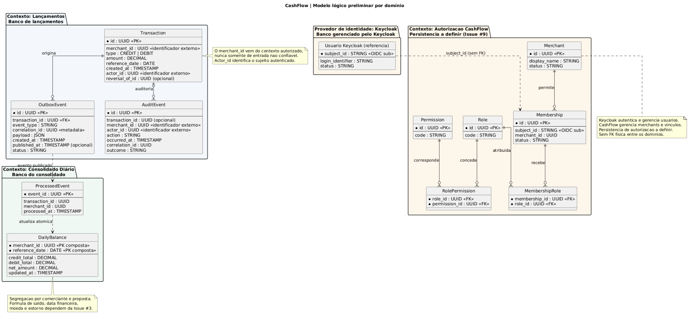

# Modelo de Dados (Data Model View)

> **Projeto:** CashFlow Architecture · **Issue #6 / Milestone M2**  
> **Estado:** modelo lógico alinhado às decisões do MVP de 15/11/2026; migrations e testes pendentes

## 1. Objetivo

Mostrar **quais informações cada domínio precisa manter**, seguindo a decisão PostgreSQL/EF Core da ADR-003, sem apresentar tipos e índices do diagrama como migrations já executadas. O desafio exige lançamentos e consolidado diário; **auditoria, Outbox e processamento idempotente** foram adotados para proteger os dados financeiros e garantir resiliência. O **Keycloak** foi escolhido para identidade na ADR-006.

**[Fonte editável do diagrama PlantUML](plantuml/data-model.puml)**

> **PNG a regenerar após a Validação 03:** a fonte `plantuml/data-model.puml` foi ajustada para representar `actor_id` como identificador textual OIDC e explicitar a unicidade de `ProcessedEvent.event_id`. Substituir `images/data-model.png` após a renderização.

## 2. Dados por contexto

| Contexto | Entidade proposta | Para que serve |
| --- | --- | --- |
| Keycloak (provedor de identidade) | **User (referência)** | Conta, credenciais e identidade gerenciadas pelo Keycloak; identificada para o CashFlow pelo claim `sub`. |
| Autorização CashFlow (banco lógico próprio no MVP) | **Merchant** | Cadastro do comerciante (proposto). |
| Autorização CashFlow (banco lógico próprio no MVP) | **Membership** | Vínculo entre sujeito autenticado (`sub`) e comerciante. |
| Autorização CashFlow (banco lógico próprio no MVP) | **Role / Permission** | Papéis e permissões de negócio e suas associações aos vínculos. |
| Lançamentos | **Transaction** | Registro financeiro confirmado: tipo, valor, data e identificador. |
| Lançamentos | **OutboxEvent** | Evento persistido junto ao lançamento, aguardando publicação confiável. |
| Lançamentos | **AuditEvent** | Trilha de auditoria sobre ações relevantes, especialmente criação, tentativa de correção, estorno e operações administrativas. |
| Consolidado diário | **DailyBalance** | Projeção dos totais de crédito/débito e movimento líquido por dia, com saldo acumulado para consulta. A materialização do acumulado e seu recálculo após movimentos retroativos ainda devem ser definidos. |
| Consolidado diário | **ProcessedEvent** | Identificadores de eventos já aplicados, impedindo contagem dupla. |

O **Keycloak é a fonte de identidade e autenticação**, incluindo o identificador estável do sujeito (`sub`), credenciais e configuração OIDC. A **autorização de negócio e os vínculos com comerciantes pertencem ao CashFlow**, com **banco lógico próprio de autorização e consulta servidor-side com cache curto e invalidação** decididos para o MVP. O contrato de acesso, TTL e responsabilidade de implantação ainda exigem especificação. O `merchant_id` e o `actor_id` em registros financeiros são referências lógicas, **sem FK física** entre domínios. O `actor_id` foi representado como **STRING** no modelo lógico para acomodar o claim `sub` OIDC sem presumir UUID; caso adotemos um identificador interno distinto, será necessário documentar o mapeamento e a escolha do namespace do emissor. O banco de lançamentos continua sendo a fonte de verdade dos registros financeiros. O consolidado guarda uma visão derivada que deve poder ser reconstruída, conforme estratégia a ser definida na Issue #8.

### Relações importantes

- A segregação por comerciante **aprovada para o MVP** adiciona `merchant_id` em **Transaction**, **AuditEvent**, **DailyBalance** e **ProcessedEvent**. A chave lógica sugerida para **DailyBalance** passa a ser `(merchant_id, reference_date)`.
- **Membership** associa usuários a comerciantes; os papéis podem ser atribuídos por vínculo, permitindo que a mesma pessoa tenha permissões distintas em estabelecimentos diferentes.
- O serviço financeiro deve garantir que o `merchant_id` utilizado está **autorizado para o sujeito autenticado**, não apenas aceitar um identificador arbitrário no payload ou na URL.
- A emissão e validade dos tokens dependem do Keycloak conforme a ADR-006. A revogação e atualização dos vínculos de autorização de negócio dependem da Issue #9; não devemos copiar senhas ou tokens para os bancos financeiros.

- Um lançamento pode originar um evento da Outbox; no futuro pode originar outros eventos do ciclo de vida. A Outbox e o lançamento podem ser gravados **na mesma transação**.
- Um lançamento pode estar relacionado a registros de auditoria. A auditoria de sua criação, quando for requisito de consistência, deve ser persistida **na mesma transação** do lançamento, ou por um mecanismo com garantias equivalentes.
- **AuditEvent não substitui Transaction**, e não transforma a solução automaticamente em Event Sourcing.
- O **event_id** de `ProcessedEvent` deve ser **único** no banco de Consolidation, sem FK física para Outbox. O identificador do registro de Outbox que originou o evento deve ser estável durante retries, mas o mapeamento do envelope e do ID do evento será detalhado no contrato.
- O **correlation_id** é um metadado técnico presente em **OutboxEvent** e **AuditEvent**, propagado também nos headers da mensagem. Ele associa registros, eventos e logs da mesma operação; não identifica o lançamento nem substitui o ID do evento.
- **Transaction** não precisa de correlation_id para representar o fato financeiro. **DailyBalance** não deve receber esse campo, pois agrega várias operações; em **ProcessedEvent** ele é opcional, já que o event_id permite rastrear a origem.
- **ProcessedEvent e DailyBalance** devem ser atualizados atomicamente ao consumir um evento; em caso de reentrega, o ID já processado impede a soma novamente.
- **Não existem chaves estrangeiras entre domínios** de Keycloak, autorização CashFlow, Lançamentos e Consolidado. A ligação entre identidades e regras de acesso ocorre por identificadores estáveis; entre os serviços financeiros, também por eventos.

## 3. Auditoria financeira proposta

Para cada ação relevante, uma trilha de auditoria deve permitir responder:

| Informação | Exemplo ou uso |
| --- | --- |
| **Quem** | Identificador interno do usuário ou serviço (quando disponível) |
| **O quê** | Lançamento criado, estorno solicitado, operação rejeitada |
| **Quando** | Instante da ação, em UTC |
| **Sobre qual registro** | ID do lançamento, quando aplicável |
| **Resultado** | Sucesso, rejeição ou falha |
| **Rastreabilidade** | Correlation ID da solicitação, também persistido na Outbox e propagado à mensageria |

**Política proposta:** registros de auditoria são **append-only**: não devem ser alterados ou excluídos por usuários da aplicação. Isso **não equivale a armazenamento à prova de adulteração**; proteção contra alteração por administradores exigiria controles adicionais, como armazenamento imutável, trilhas externas, restrições de privilégio e monitoramento.

**Privacidade e segurança:** não copiar tokens, senhas ou dados pessoais desnecessários para `details`. Retenção, acesso à auditoria, criptografia e tratamento de dados pessoais serão definidos na Issue #9. Falhas de autenticação ou solicitações rejeitadas podem ser auditadas fora da transação financeira, sem transformar toda tentativa de acesso em lançamento.

### Metadados de correlação e tracing

- **transaction_id** identifica um lançamento financeiro.
- **event_id** identifica um evento individual e permite deduplicação no consumidor.
- **correlation_id** associa requisições, mensagens, auditoria e logs de um mesmo fluxo, inclusive quando há reprocessamentos.
- O worker publica o correlation_id como **header da mensagem** (proposta de contrato AMQP) e o consumidor preserva o valor em seus logs e telemetria.
- **trace_id** e **span_id**, quando houver OpenTelemetry, são identificadores de tracing distribuído e não substituem o correlation_id de negócio/operação.

## 4. Regras de integridade propostas

1. **RN-07 decidida:** apenas BRL no MVP; montantes financeiros são `decimal` no .NET e `numeric(19,2)` no PostgreSQL, **nunca ponto flutuante binário**. `Transaction.amount > 0`; rejeitar valores com mais de duas casas decimais, sem arredondamento implícito; `CREDIT` aumenta e `DEBIT` reduz o movimento líquido, sem guardar débito como valor negativo.
2. Lançamentos confirmados preservam histórico; **consulta paginada por período e comerciante integra o MVP**. Estorno, edição e exclusão de fatos financeiros confirmados ficam **fora do MVP**, reservados para evolução.
3. `AuditEvent` de **registro confirmado** integra o MVP, com ator, `merchant_id`, `transaction_id`, ação, horário UTC e correlação, preservando atomicidade quando necessário; retenção inicial **365 dias**, sujeita à revisão legal.
4. A confirmação do registro depende do armazenamento confiável do lançamento e da Outbox, **não** da disponibilidade do consolidado.
5. Eventos reprocessados não podem modificar o saldo mais de uma vez.
6. O consolidado pode ser eventualmente consistente, e qualquer diferença de atualização deve ser observável.
7. Um evento de competência passada deve alterar o movimento líquido daquela competência e **todos os saldos acumulados posteriores** do comerciante, sem alterar os fatos financeiros originais. Eventos fora de ordem e duplicados não podem gerar saldos finais incorretos.

## 5. Campos ainda não fechados

- **Saldo diário: decidido exibir ambos.** `net_amount = credit_total - debit_total`; `closing_balance` corresponde ao saldo inicial somado aos movimentos líquidos até a data. **RN-03 decidida:** saldo inicial de **R$ 0,00 por comerciante no MVP**, sem lançamento de abertura ou campo configurável obrigatório. **RN-09 decidida:** quando não houver movimentações em uma data, créditos/débitos/líquido são zero e o saldo acumulado permanece igual ao anterior (ou R$ 0,00 antes do primeiro lançamento). **Não é obrigatório persistir uma linha de `DailyBalance` para cada dia sem lançamentos.** **Competências retroativas são permitidas:** a projeção deve atualizar o movimento do dia de competência e refletir o efeito em todos os saldos acumulados posteriores. **Estratégia aprovada:** persistir apenas os totais de cada dia e **calcular o saldo acumulado na leitura**, somando os `net_amount` das competências até a data consultada. `closing_balance` é **derivado**, não coluna persistida no MVP. Eventos retroativos corrigem os totais do dia e o acumulado das leituras seguintes reflete a correção. Índices, concorrência e desempenho precisam de testes.
- **RN-04 decidida:** `Transaction.reference_date` guarda a **data de competência informada pelo comerciante** (`DATE`), independente do instante de criação; `Transaction.created_at` guarda o **instante real de registro em UTC**. O `DailyBalance.reference_date` representa o dia de competência. **Regra complementada:** permitir competências anteriores ou iguais à data atual do negócio e rejeitar futuras; o lançamento retroativo recompõe o acumulado desde a data informada. **America/Sao_Paulo** define a data atual, inclusive para rejeitar datas futuras, e é o fuso de apresentação inicial; o formulário sugere hoje, mas o campo é editável. Competências passadas são permitidas **sem limite de dias** para usuários autorizados. Instantes persistidos em UTC.
- **Identidade e autorização:** banco lógico de autorização CashFlow separado de Transactions, Consolidation e Keycloak. Dois papéis do MVP: **ADMIN** e **OPERATOR** por `merchant_id`; consultar vínculos com cache curto e invalidação, sem aceitar um `merchant_id` arbitrário. Não criar FK entre esses bancos. A matriz detalhada de permissões, mecanismo de acesso, TTL e revogação ainda devem ser implementados.
- **Identidade e autorização:** Keycloak é o provedor escolhido para autenticação. `actor_id` representa referência textual ao sujeito OIDC, não UUID obrigatório. Definir issuer/namespace e, se houver ID interno, o mapeamento. A segregação por comerciante é uma regra do CashFlow; armazenamento, cardinalidades e fluxos de cadastro ainda precisam ser validados.
- **Moeda e arredondamento (RN-07 decidida):** BRL, escala 2, `decimal`/`numeric(19,2)`, valores de lançamento estritamente positivos e rejeição de precisão acima de duas casas. `credit_total`/`debit_total` são totais não negativos; `net_amount` e `closing_balance` podem ser negativos pelo cálculo. Impor as regras nos contratos, domínio e constraints de banco. A política de valores máximos e overflow deve ser verificada no modelo físico.
- **Correções:** estorno fica para próxima versão; regra de compensação a decidir antes dessa evolução.
- **Auditoria:** registros financeiros confirmados no MVP; retenção inicial 365 dias. Detalhar expurgo, papéis que podem consultar e conformidade legal.
- **Tecnologia:** modelo PostgreSQL/EF Core aprovado; constraints, índices, migrations, transações e validação em execução ficam para implementação.

**Nota:** `actor_id`, `reversal_of_id` e a chave de `DailyBalance` são indicativos. Poderão mudar conforme a definição de multiusuário, comerciantes e cálculo do saldo.

## 6. Validação do modelo lógico

As [ADRs de dados](adr/ADR-003-database-and-persistence.md) e de [Outbox/idempotência](adr/ADR-005-outbox-consistency-idempotency.md) fundamentam o modelo; consulte também os [requisitos](../requirements/functional-requirements.md). Permanecem pendentes migrations, índices, performance do acumulado derivado, interface/revogação de autorização e contratos de evento. As escolhas do MVP estão em [Decisões consolidadas](mvp-decisions.md). A revisão do diagrama **não é evidência de migrations executadas ou integridade verificada em banco**.

## 7. Rastreabilidade

| Requisito / risco | Elementos relacionados |
| --- | --- |
| RF-01 / RF-02: registrar movimentações | Transaction, OutboxEvent |
| RF-03: consultar consolidado | DailyBalance |
| RNF-01: independência em falhas | OutboxEvent |
| RNF-04: não perder lançamento confirmado | Transaction + OutboxEvent |
| RNF-05: idempotência | ProcessedEvent + DailyBalance |
| R-01 / R-03: perda ou duplicidade | Transações atômicas, Outbox e deduplicação |
| R-06: dados sensíveis | AuditEvent com campos mínimos, Keycloak e autorização de negócio com política de acesso |
| Segregação de comerciantes (proposta) | Merchant, Membership e merchant_id nas projeções e lançamentos |

**Próximos passos:** validar este modelo com as regras de negócio da Issue #3; formalizar decisões de armazenamento e auditoria nas ADRs (#7); detalhar segurança e retenção (#9).

## Complemento de modelo físico para implementação

- **DailyBalance:** PK `(merchant_id, reference_date)`, totais `credit_total`, `debit_total` e `net_amount` em `numeric(19,2)`; `closing_balance` **não é coluna persistida**. Em consulta, somar `net_amount` até a competência solicitada, inclusive quando não houver registro no próprio dia. Verificar plano, índice e custo de leitura em 50 RPS.
- **HttpIdempotencyRecord:** entidade técnica de Transactions a modelar, com escopo por comerciante/rota, chave, fingerprint da requisição, identificador/resultado associado e retenção; commit em conjunto com `Transaction + OutboxEvent`.
- **AuditEvent:** registrar criação financeira **confirmada**, vincular ao lançamento e garantir consistência transacional; retenção inicial 365 dias com expurgo autorizado e testado.
- **Autorização CashFlow:** banco lógico próprio para `Merchant`, `Membership` e papéis `ADMIN`/`OPERATOR`; não é o banco Keycloak e não implica novo microsserviço financeiro. O proprietário e a interface de consulta serão definidos antes de implementar.
- **OutboxEvent / ProcessedEvent:** envelope com `event_id`, `event_type`, `schema_version`, `correlation_id`, retenção configurável e expurgo seguro; não eliminar deduplicação enquanto ainda existir possibilidade de reentrega não coberta por outra garantia.
