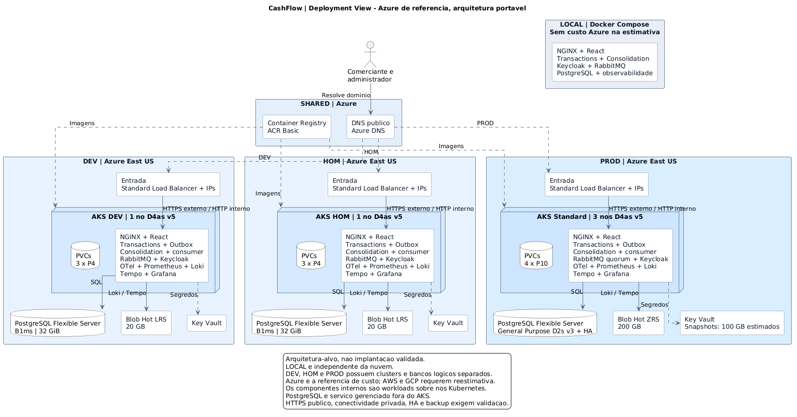

# Deployment View | CashFlow

## Objetivo

Esta visão distingue **a execução LOCAL desta primeira etapa** do **desenho futuro de implantação em Azure** e como se distribuem entre **LOCAL, DEV, HOM, PROD e SHARED**. Complementa os diagramas C4, que explicam responsabilidades, e o orçamento Azure, que explica custos dos recursos provisionados.

A **Azure East US permanece a plataforma de referência para implantação futura** e a base da calculadora; **nenhum recurso Azure será provisionado agora**. O desenho emprega capacidades arquiteturais reutilizáveis (Kubernetes, PostgreSQL, AMQP/RabbitMQ, Keycloak, OTLP, armazenamento de objetos, registro de imagens, DNS e gestão de segredos). **Portabilidade não significa migração automática nem equivalência integral de preços, rede, segurança, disponibilidade ou operação**.

## Diagrama geral de deployment

**[Fonte PlantUML editável](plantuml/deployment-view.puml)**

O arquivo PlantUML apresenta **LOCAL**, **SHARED**, **DEV**, **HOM** e **PROD**, com o relacionamento entre os clusters Kubernetes, serviços gerenciados de banco e storage, workloads e compartilhamento de imagens/DNS.

A imagem renderizada está disponível em `docs/architecture/images/deployment-view.png`. Ao alterar o PlantUML, renderize novamente o PNG correspondente para manter a documentação sincronizada.

## Modelo vigente de bancos e autorização, revisão de 16/11/2026

Cada ambiente mantém **três bancos lógicos PostgreSQL: Transactions, Consolidation e Keycloak**. O Keycloak gerencia identidade, grupos e vínculos ADMIN/OPERATOR por comerciante. **Não há quarto banco lógico de Autorização CashFlow nem serviço de autorização separado**, conforme a [ADR-006 vigente](adr/ADR-006-identity-and-access.md). O texto de 15/11/2026 sobre o quarto banco foi substituído em 16/11/2026.

O compartilhamento de uma instância física de PostgreSQL por ambiente é apenas hipótese de custo e não comprova isolamento ou capacidade. PROD continua condicionado a backups automáticos, restauração comprovada e aprovação humana efetiva pelo GitHub Environments. O diagrama [PlantUML](plantuml/deployment-view.puml) contém uma legenda histórica inconsistente que ainda enumera quatro bancos sob o título de três; **corrigir a fonte e regenerar o PNG correspondente antes de declarar o conjunto de diagramas sincronizado**. Até lá, esta página e a ADR-006 expressam a decisão vigente. [Decisões consolidadas do MVP](mvp-decisions.md).

## Sequência de implantação

**Agora:** implementar e testar todo o MVP **somente com Docker Compose local**, incluindo três bancos lógicos PostgreSQL, RabbitMQ, Keycloak, React/NGINX e APIs .NET. Os critérios funcionais, resiliência, autorização e carga podem ser exercitados localmente, com resultados vinculados ao hardware do teste.

**Futuro:** avaliar quando provisionar DEV/HOM/PROD/SHARED em Azure e executar então testes próprios de AKS, redes, HA, custos, recuperação, aprovação de PROD e desempenho em nuvem. O diagrama inclui os ambientes futuros para preservar a arquitetura-alvo, 
**não uma implantação realizada**.

## Distribuição dos ambientes

| Grupo | Topologia e função | Isolamento / custo de referência |
| --- | --- | --- |
| **LOCAL** | Docker Compose; desenvolvimento com NGINX, React, APIs .NET, PostgreSQL, RabbitMQ, Keycloak e telemetria | Executa no computador local, **US$ 0,00 de Azure** (não inclui custo do hardware) |
| **DEV** | Um AKS com um nó D4as v5 (4 vCPU/16 GiB), três PVCs P4 e PostgreSQL Flexible Server B1ms/32 GiB, Blob Hot LRS 20 GB, Load Balancer/IPs e Key Vault | Cluster, banco lógico, segredos e storage segregados, **US$ 204,34/mês** |
| **HOM** | Configuração econômica equivalente a DEV, mas com recursos próprios | Homologação isolada, sem aumento temporário de porte no orçamento, **US$ 204,34/mês** |
| **PROD** | AKS Standard com três nós D4as v5, quatro PVCs P10, PostgreSQL Flexible Server General Purpose D2s v3 com HA habilitada, Blob Hot ZRS 200 GB, LB/IPs, Key Vault e 100 GB de snapshots estimados | Plataforma de produção ainda requer testes de HA e capacidade, **US$ 890,44/mês** |
| **SHARED** | Um Azure Container Registry Basic e uma zona Azure DNS pública | Compartilhados entre DEV, HOM e PROD, **US$ 5,90/mês** |
| **TOTAL** | Estimativa dos itens orçados, não TCO garantido | **US$ 1.305,02/mês**, cerca de **US$ 15.660,24/ano** |

Os valores são os confirmados na [Azure Pricing Calculator e registrados no plano financeiro](four-environment-total-cost-plan.md). O plano financeiro continua sendo a **fonte única dos custos detalhados por item**. Não duplicar o custo de ACR ou DNS em DEV, HOM ou PROD.

## O que roda dentro e fora de cada AKS

**Dentro dos clusters Kubernetes**, a arquitetura-alvo agrupa NGINX, entrega estática do frontend React, Transactions API/Outbox worker, Consolidation API/consumer, RabbitMQ, Keycloak, OpenTelemetry Collector, Prometheus, Loki, Tempo e Grafana. São workloads isolados logicamente, não nós ou serviços cobrados individualmente. Os bancos das aplicações ficam **fora do AKS**, no PostgreSQL Flexible Server, com bancos **lógicos** próprios de Transactions, Consolidation e Keycloak dentro da instância por ambiente, conforme o plano financeiro.

Os PVCs sobre Managed Disks suportam dados persistentes dentro do cluster. O Blob Storage é previsto para dados de Loki/Tempo. O acesso a segredos usa Key Vault por ambiente. O ACR compartilhado disponibiliza imagens aos três clusters; as permissões e pipelines continuam separados. O DNS público compartilhado aponta os nomes necessários a entradas de cada ambiente; ele **não equivale a compartilhar um Load Balancer ou um único cluster**.

**Entrada de usuários:** HTTPS público em **TCP 443** é a topologia pretendida, com terminação TLS/Ingress ainda a configurar. O template atual de NGINX escuta **HTTP interno 8080**. As APIs também usam **8080 como exemplo de upstream**, não como configuração de código já verificada. RabbitMQ, PostgreSQL, Keycloak interno e observabilidade não devem ser expostos publicamente sem necessidade. O navegador precisa acessar endpoints OIDC de Keycloak com HTTPS, por uma rota pública protegida apropriada.

A ligação **NGINX → Keycloak** para autenticação na borda aparece no C4 como **alternativa futura** e exigiria configuração específica, como `auth_request` mais adaptador OIDC; o fluxo decidido para o MVP é React → Keycloak via OIDC/PKCE, com validação JWT local em cada API usando JWKS e autorização por `merchant_id`.

## Capacidade de migrar para outras clouds

A arquitetura usa **interfaces e produtos que possuem opções equivalentes** em provedores diferentes, mas a transição implica revisão de infraestrutura como código, identidades, ingress, DNS, storage, observabilidade, limites e preços. A tabela apresenta mapeamentos **conceituais**, não a decisão de utilizar simultaneamente três provedores.

| Capacidade lógica | Azure selecionado | Alternativa AWS | Alternativa GCP |
| --- | --- | --- | --- |
| Kubernetes gerenciado | AKS | Amazon EKS | Google Kubernetes Engine |
| PostgreSQL gerenciado | Azure Database for PostgreSQL Flexible Server | Amazon RDS for PostgreSQL | Cloud SQL for PostgreSQL |
| Armazenamento de objetos | Azure Blob Storage | Amazon S3 | Cloud Storage |
| Registry de containers | Azure Container Registry | Amazon ECR | Artifact Registry |
| Segredos e chaves | Azure Key Vault | AWS Secrets Manager / KMS | Secret Manager / Cloud KMS |
| DNS público | Azure DNS | Amazon Route 53 | Cloud DNS |
| Load balancing/Ingress | Azure Standard Load Balancer + Ingress no AKS | AWS Load Balancers + Ingress no EKS | Cloud Load Balancing + Ingress no GKE |
| Persistência de volumes | Azure Managed Disks | Amazon EBS | Persistent Disk |
| Workloads de mensageria | RabbitMQ self-hosted em AKS | RabbitMQ em EKS; Amazon MQ pode exigir adaptações | RabbitMQ em GKE ou solução alternativa |
| Identidade de usuário | Keycloak no AKS | Keycloak no EKS | Keycloak no GKE |
| Telemetria | OTel, Prometheus, Loki, Tempo e Grafana em AKS | Mesma stack em EKS, com integrações AWS opcionais | Mesma stack em GKE, com integrações GCP opcionais |

**Cuidado com compatibilidade:** nomes similares não garantem equivalência de SLAs, latência, limites, billing ou mecanismo de identidade. RabbitMQ autogerenciado é tecnicamente portátil como contêiner, mas disponibilidade, discos, rede e recuperação continuam dependentes do provedor. O mesmo vale para backup do PostgreSQL e snapshots de volumes.

## Decisões e validações pendentes de deployment

1. **Kubernetes e resiliência:** configurar recursos, réplicas, HPA, Cluster Autoscaler, probes, PDB e distribuição entre nós/zonas; três nós em PROD e volumes de RabbitMQ quorum são planos, não provas de HA/N+1.
2. **Banco:** selecionar e confirmar a opção **zone-redundant** de PostgreSQL PROD e executar testes de failover/restore. O preço já contém HA habilitada na calculadora, não comprova failover.
3. **Ingress e rede:** validar Load Balancer, TLS externo, dois endereços IP previstos por ambiente, saída via Load Balancer, SNAT e eventual necessidade de NAT ou conectividade privada. O desenho não afirma que a rede esteja aprovada/implantada.
4. **Backup:** 100 GB de snapshots PROD são **capacidade de armazenamento orçada**, não sete dias garantidos nem restauração consistente de RabbitMQ. Definir RPO/RTO, retenção e testes.
5. **Escala de DEV/HOM:** confirmar que a stack completa cabe em um nó de 4 vCPU/16 GiB. HOM segue econômico por decisão; testes que exijam capacidade próxima de PROD precisam de recursos apropriados não orçados.
6. **Segurança:** isolamento de identidades/permissões por ambiente, controle de acesso ao ACR Basic (sem Private Endpoint), Key Vault, TLS e não exposição de componentes internos.
7. **Portabilidade:** qualquer migração para AWS/GCP requer uma nova estimativa e validação dos mecanismos concretos de plataforma, sem alterar automaticamente a decisão Azure da ADR-009.

## Referências

- [ADR-009: Decisão de implantação e cloud](adr/ADR-009-deployment-cloud.md)
- [Four Environment Total Cost Plan](four-environment-total-cost-plan.md)
- [C4 Model: Building Block View](building-block-view.md)
- [ADR-010: GitHub Actions](adr/ADR-010-ci-cd-github-actions.md)
- [Fonte editável do diagrama de deployment](plantuml/deployment-view.puml)
