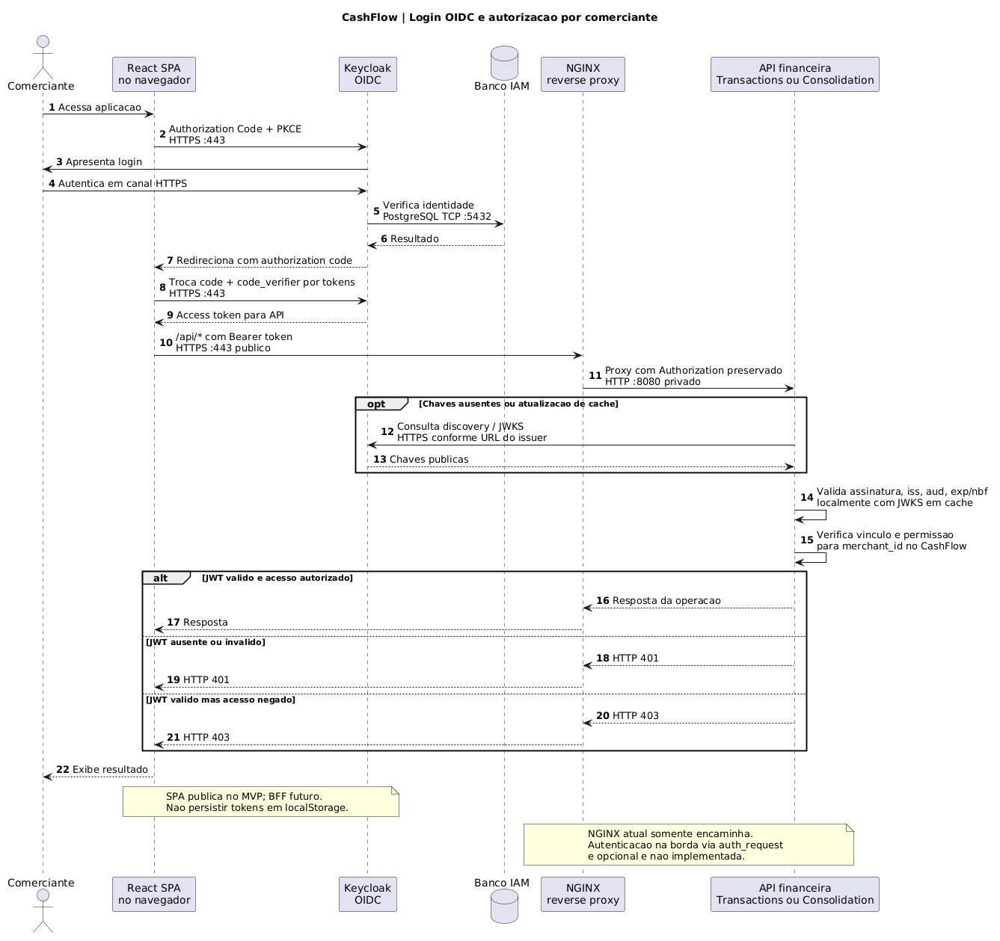
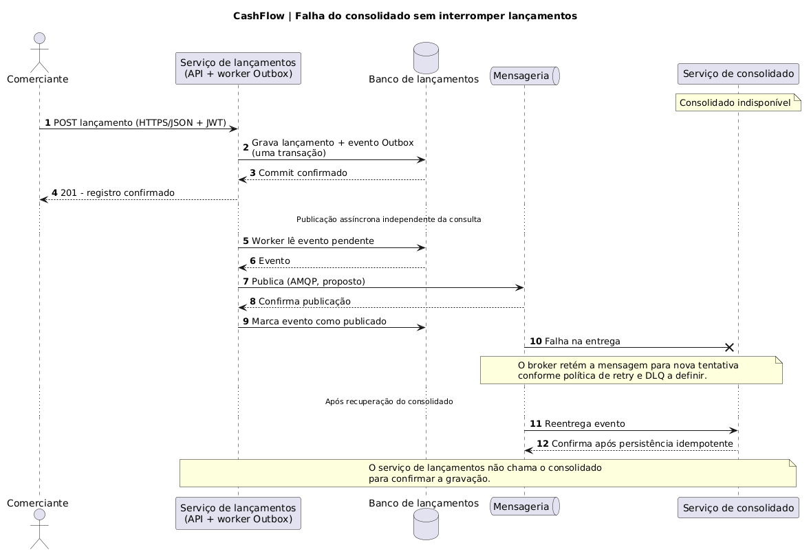

# Diagramas de Sequência

> **Issue #6 · Milestone M2** | Interações da arquitetura proposta

Este documento reúne os **diagramas de sequência**. Eles detalham em que ordem os participantes interagem. Complementam os [Casos de Uso](use-cases.md), mostrando como os serviços interagem. Os cenários de resiliência serão detalhados na Issue #8.

## Autenticação e autorização por comerciante

Fluxo conceitual de autenticação no **Keycloak** com OIDC (Authorization Code + PKCE para clientes públicos), obtenção do access token, passagem pelo API Gateway e autorização por comerciante no serviço financeiro. O Keycloak não armazena necessariamente os vínculos financeiros entre usuários e comerciantes. A decisão está formalizada na [ADR-006](adr/ADR-006-identity-and-access.md).

[Fonte PlantUML](plantuml/sequence-auth.puml)

## Registro de lançamento e publicação assíncrona

A interface envia o registro ao API Gateway, que encaminha ao serviço de lançamentos. A API financeira valida o token, as permissões e o comerciante autorizado antes de gravar o lançamento. O registro é confirmado antes da publicação do evento.

[Fonte PlantUML](plantuml/sequence-register.puml)

## Falha do consolidado

Mesmo com o consolidado indisponível, o serviço de lançamentos consegue registrar uma movimentação. A entrega pode ser retomada após a recuperação do consumidor.

[Fonte PlantUML](plantuml/sequence-failure.puml)

## Consulta do consolidado diário

A aplicação Web/Mobile consulta pelo API Gateway. O serviço de consolidado valida o JWT e as permissões de leitura e acessa sua própria base, filtrando pelo comerciante autorizado. Não precisa consultar o serviço de lançamentos.

[Fonte PlantUML](plantuml/sequence-query.puml)

**Manutenção:** regenerar os PNGs dos diagramas quando as respectivas fontes PlantUML forem alteradas. A ADR-007 poderá modificar os fluxos de clientes e autenticação após aprovação.

**Nota:** os protocolos e as formas de integração são propostas de arquitetura, a confirmar nos ADRs. As regras exatas do cálculo de saldo e o tratamento de eventual atraso continuam pendentes na Issue #3.
