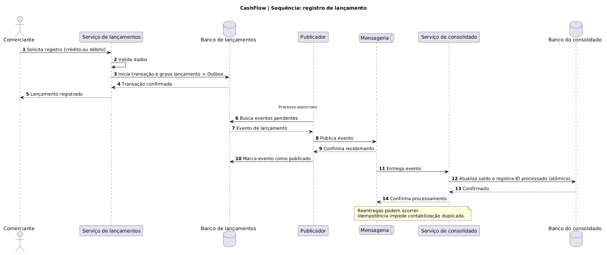
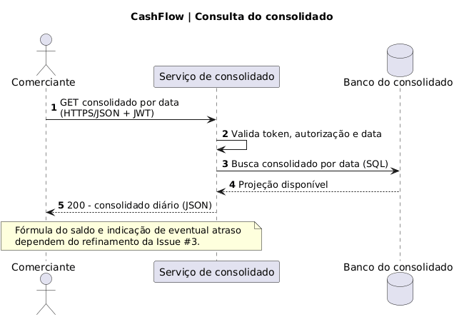

# Diagramas de Sequência

> **Issue #6 · Milestone M2** | Interações da arquitetura proposta

Este documento reúne os **diagramas de sequência**. Eles detalham em que ordem os participantes interagem. São evidências visuais da [Visão de Execução](runtime-view.md).

## Registro de lançamento e publicação assíncrona

O lançamento é confirmado após a gravação no banco, antes da publicação do evento.

[Fonte PlantUML](plantuml/sequence-register.puml)

## Falha do consolidado

Mesmo com o consolidado indisponível, o serviço de lançamentos consegue registrar uma movimentação. A entrega pode ser retomada após a recuperação do consumidor.

[Fonte PlantUML](plantuml/sequence-failure.puml)

## Consulta do consolidado diário

A consulta acessa a própria base do consolidado e não precisa consultar o serviço de lançamentos.

[Fonte PlantUML](plantuml/sequence-query.puml)

**Nota:** os protocolos e as formas de integração são propostas de arquitetura, a confirmar nos ADRs. As regras exatas do cálculo de saldo e o tratamento de eventual atraso continuam pendentes na Issue #3.
