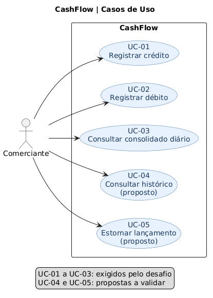

# Casos de Uso (Use Case View)

> **Projeto:** CashFlow Architecture · **Milestone:** M2  
> **Base:** requisitos funcionais da Issue #3 e mapeamento de negócio da Issue #2  
> **Situação:** escopo funcional do MVP decidido em 15/11/2026; testes pendentes

## 1. Objetivo

Esta visão descreve **o que o comerciante deseja fazer no CashFlow**, independentemente de linguagem, framework ou tecnologia de integração.

O desafio exige o registro de débitos e créditos e a consulta ao consolidado diário. Consulta de histórico, validações adicionais e estorno são propostas a serem refinadas, não exigências confirmadas.

## 2. Diagrama de casos de uso

O diagrama diferencia os casos de uso exigidos dos sugeridos. Atores externos adicionais não foram presumidos.

**Fonte editável:** [use-cases.puml](plantuml/use-cases.puml).

## 3. Casos de uso principais

| Código | Caso de uso | Ator | Origem |
| --- | --- | --- | --- |
| UC-01 | Registrar crédito | Comerciante | Exigido |
| UC-02 | Registrar débito | Comerciante | Exigido |
| UC-03 | Consultar consolidado diário | Comerciante | Exigido |
| UC-04 | Consultar histórico de lançamentos | Comerciante | Proposto, **aprovado para MVP** |
| UC-05 | Estornar lançamento | Comerciante | Proposto, **próxima versão** |

### UC-01: Registrar crédito

**Objetivo:** registrar uma entrada financeira classificada como crédito.

**Pré-condição proposta:** comerciante autorizado a registrar movimentações.

**Fluxo principal:**
1. O comerciante informa os dados do crédito.
2. O sistema valida os dados informados.
3. O sistema registra o lançamento.
4. O comerciante recebe a confirmação.

**Alternativa:** se os dados forem inválidos, o sistema informa o problema e não confirma o registro.

**Pós-condição:** crédito registrado e disponível para consolidação.

### UC-02: Registrar débito

**Objetivo:** registrar uma saída financeira classificada como débito.

**Pré-condição proposta:** comerciante autorizado a registrar movimentações.

**Fluxo principal:**
1. O comerciante informa os dados do débito.
2. O sistema valida os dados.
3. O sistema registra o lançamento.
4. O comerciante recebe a confirmação.

**Alternativa:** dados inválidos impedem a confirmação.

**Pós-condição:** débito registrado e disponível para consolidação.

### UC-03: Consultar consolidado diário

**Objetivo:** consultar o resultado financeiro referente a uma data.

**Pré-condição proposta:** comerciante autorizado a consultar o consolidado.

**Fluxo principal:**
1. O comerciante informa a data.
2. O sistema consulta o consolidado disponível.
3. O sistema apresenta o resultado diário.

**Alternativas:** data inválida; consolidado indisponível; resultado ainda não atualizado.

**Pós-condição:** o comerciante visualiza o resultado ou recebe uma indicação apropriada da indisponibilidade.

**RN-02 decidida em 15/11/2026:** a consulta apresenta totais de crédito, débito, **movimento líquido do dia** e **saldo acumulado**. **RN-03 decidida:** o saldo inicial é **R$ 0,00 por comerciante** no MVP. **RN-09 decidida:** em dias sem movimentações, crédito, débito e líquido são R$ 0,00 e o acumulado anterior é mantido; antes do primeiro registro, fica em R$ 0,00. **RN-04 decidida:** data de competência informada pelo comerciante e instante de registro em UTC. **RN-07 decidida:** valores em BRL, positivos e com até duas casas decimais; zero, negativos e precisão excessiva são rejeitados, sem arredondamento automático. **Complemento da RN-04 decidido:** aceitar competências passadas ou atuais, rejeitar futuras e recompor saldos acumulados afetados. Fuso de referência da data atual e estratégia física de recomposição continuam pendentes.

## 4. Casos de uso sugeridos

### UC-04: Consultar histórico de lançamentos

**Objetivo:** conferir os registros de determinado período.

**Fluxo resumido:** o comerciante escolhe um período e visualiza os lançamentos correspondentes.

**Situação:** aprovado para o MVP, com filtro por período, paginação e autorização por comerciante.

### UC-05: Estornar lançamento

**Objetivo:** corrigir o efeito de um lançamento incorreto sem perder sua rastreabilidade.

**Fluxo resumido:** o comerciante identifica o lançamento original, solicita o estorno e recebe a confirmação do ajuste.

**Situação:** fora do MVP, previsto para próxima versão. Regra de autorização, dia de efeito e política de estorno serão definidos quando implementado.

## 5. Escopo aprovado em 15/11/2026\n\nAlém de UC-01 a UC-03, **UC-04 integra o MVP**. A auditoria básica de registros financeiros confirmados é mecanismo interno aprovado, sem caso de uso público de administração. O sistema é multicomerciante, com papéis ADMIN e OPERATOR por estabelecimento. O formulário inicia na data atual de `America/Sao_Paulo`, editável; lançamentos retroativos são admitidos sem limite de dias com autorização. O acumulado deriva de totais diários persistidos. **UC-05 fica fora do MVP.** Consulte [Decisões consolidadas](mvp-decisions.md).\n\n## 6. Relação com a documentação

| Necessidade | Documento |
| --- | --- |
| Regras e critérios de aceite | [Requisitos funcionais](../requirements/functional-requirements.md) |
| Estrutura e responsabilidades dos serviços | [Building Block View](building-block-view.md) |
| Interações entre serviços | [Diagramas de Sequência](sequence-diagrams.md) |
| Comportamento em falhas | [Requisitos não funcionais](../requirements/non-functional-requirements.md) e futura estratégia de resiliência (Issue #8) |

Os casos de uso descrevem **ações do comerciante**. A publicação de eventos, a Outbox e a recuperação de falhas são mecanismos internos e não devem ser apresentados como casos de uso do comerciante.
